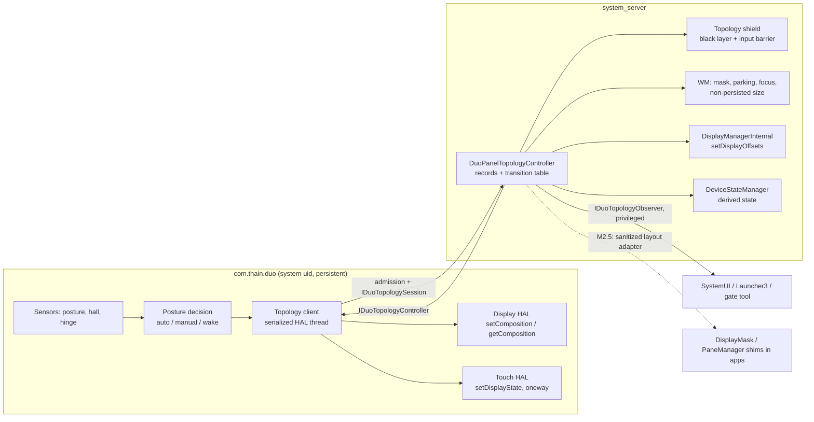

# M2.1 — Panel topology protocol and parking (design, revision 3)

Status: **design only**, for review. Implementation waits for the M2.2 (Recents feasibility) decision ([plan §16.2](dual-screen-plan.md#162-m2-order)); Recents feasibility is unproven until the M2.2 device runs, and that prerequisite stands.
Revision 2 (2026-11-04) answered the Astra (high) review of revision 1 (`523226d`). Revision 3 (2026-11-04) answers the Astra re-review of revision 2 (`4317938`): six blocking issues on barriers, input disposal, IME, recovery entry paths, parking normalization and DeviceState publication (§0.2). F21 (fw 0017) is unchanged.
Target: Surface Duo 1, DUO-DE Android 16 r4, per-panel DisplayAreaGroup architecture (fw 0008).
Inputs: [dual-screen-plan.md](dual-screen-plan.md) §3, §4, §16.1 (F2, F6, F12, F13, F21), §16.2 M2.1, §17; [m1-gate-report.md](m1-gate-report.md) G7 and hinge sensor characteristics.

## How to read the citations

Line numbers refer to the r4 tree **with the M1 gate-image patch series applied** (tag `m1-gate-image`; `frameworks/base` HEAD `ba86d80`), read only from `\\wsl.localhost\duo-build\home\builder\aosp` on 2026-11-04. The shared tree is re-patched by other work. Files that DUO-DE patches add (`DDAPP`, `DPG`, the `FLAG_FORCE_HIDDEN_FOR_DUO_PANEL` hunks) may therefore be missing or shifted when you read it; re-apply the series at `m1-gate-image` to reproduce the line numbers. Unpatched AOSP files are unaffected. Abbreviations:

| Short | Path |
|---|---|
| `PPS` | `packages/thain/services/PostureProcessor/src/main/kotlin/com/thain/duo/PostureProcessorService.kt` (Archfx/duoPosture @ `365d924`, `build/dev/pinned.xml:36`) |
| `Tile` | `.../com/thain/duo/PostureTileService.kt` |
| `PPManifest` | `packages/thain/services/PostureProcessor/src/main/AndroidManifest.xml` |
| `wm/` | `frameworks/base/services/core/java/com/android/server/wm/` |
| `DDAPP` | `wm/DuoDisplayAreaPolicyProvider.java` (fw 0008/0014/0016) |
| `DPG` | `frameworks/base/core/java/com/android/internal/policy/DuoPanelGeometry.java` (fw 0007) |
| `display/`, `DMS` | `frameworks/base/services/core/java/com/android/server/display/`, `display/DisplayManagerService.java` |
| `devicestate/`, `DSMS` | `frameworks/base/services/core/java/com/android/server/devicestate/`, `devicestate/DeviceStateManagerService.java` |
| `DSPI` | `frameworks/base/services/core/java/com/android/server/policy/DeviceStateProviderImpl.java` |
| `DSM` | `frameworks/base/core/java/android/hardware/devicestate/DeviceStateManager.java` |
| `IMS` | `frameworks/base/services/core/java/com/android/server/input/InputManagerService.java` |
| `SC` | `frameworks/base/core/java/android/view/SurfaceControl.java` |
| `jetpack/` | `frameworks/base/libs/WindowManager/Jetpack/src/androidx/window/` |
| `sysui/` | `frameworks/base/packages/SystemUI/` |
| `L3` | `packages/apps/Launcher3` (gate branch HEAD `b83fb69`) |
| `HAL-DT`, `HAL-TP` | `vendor/surface/interfaces/displaytopology/1.0/IDisplayTopology.hal`, `vendor/surface/interfaces/touchpen/1.0/ITouchPen.hal` |
| `TIM` | `frameworks/native/services/inputflinger/reader/mapper/TouchInputMapper.cpp` |
| `IDisp` | `frameworks/native/services/inputflinger/dispatcher/InputDispatcher.cpp` |
| `TCI` | `frameworks/native/services/surfaceflinger/TransactionCallbackInvoker.cpp` |
| `IMCB` | `wm/InputManagerCallback.java` |
| `RICI` | `frameworks/base/core/java/android/view/inputmethod/RemoteInputConnectionImpl.java` |

Statements marked **(inference)** are reasoned from source but not observed on the device. Each has a matching experiment (E*n*, §12) or gate assertion (§11).

---

## 0. Review disposition

### 0.1 Astra (high) on revision 1

| # | Review point | Disposition | Where |
|---|---|---|---|
| 1 | Blocking: WM traversal completion is neither a presentation barrier nor an input barrier | Accepted. The design now has separate milestones (WM mutation, submitted, committed, presented, input-ready). A fail-closed **topology shield** (black layer + input barrier that cancels and consumes pointer streams and freezes key dispatch) covers every uncertain interval. The first implementation is a brief black transition with animations suppressed. Optimized orderings are gated on experiments E1–E5 (former Q1–Q4). I2 is rewritten. *(Barriers and input mechanism superseded in revision 3, §0.2 items 1–2.)* | §3, §6.1–6.3, §6.5, §12 |
| 2 | Blocking: recovery can restore the wrong topology after WM advanced | Accepted. Immutable in-flight and committed records are kept apart from the latest desired state. Recovery starts from the observed WM state plus a fresh HAL observation, never from the committed record alone. Added: generation checks before every side effect, HAL quiescence with late completion, one authoritative transition table, explicit committed/degraded/recovered notifications, and a separation of containment from bounded recovery. Fixed the coalescing/commit contradiction. Posture-only requests are reconciled too. | §4.2, §6.6–6.9 |
| 3 | Blocking: boot and soft reboot | Accepted. Added a `BOOT_UNKNOWN` state (no fabricated committed dual) and a shield until the first reconciliation, with a contained fallback if the controller never arrives. The legacy override migration clears **both** stores before either is applied, and the doc defines what happens to a user-chosen identical size. Added a seeded-store soft-reboot gate. | §10, A17–A19 |
| 4 | Blocking: controller authentication | Accepted. Admission is a synchronous call (uid + package by pid + single live controller). It returns a private **session Binder capability**, revoked on death and never included in snapshots. Uid/package/SELinux checks are described as admission, not isolation. A14 rewritten. | §5, A14 |
| 5 | Blocking: parking | Accepted. The parking bit belongs only to root tasks directly owned by a parked panel; descendants inherit hiding. Added normalization on nesting, reparent and unpark. The destination calculation stays pure; migration happens only after launch authorization; background delivery is handled separately. Restoring the order does not clear Home-minimize. Added tests for explicit token, feature ID, organizer, external display and denied background launch. | §7, A20 |
| 6 | Blocking: derived state | Accepted. The derivation is total, and the doc now has a competing-override policy and monitoring, requested vs observed effective state, and tests that reorder DeviceState, DisplayInfo, window bounds and rotation. Single-screen and closed no-feature behaviour is stated precisely, including Sidecar. Corrected the claim about the intersection in `rotateRectToDisplayRotation`. | §9.1–9.3, A10, A21 |
| 7 | Blocking: DisplayMask/PaneManager shims run in app processes | Accepted. Specified a sanitized app-facing layout adapter separate from the privileged snapshot (initial snapshot, side-swap with unchanged size, death/reconnect). Deferred to M2.5; Microsoft Launcher's PaneManager stays disconnected; I7 no longer claims the shims. | §9.5, I7 |
| 8 | "No fold properties ⇒ no SystemUI unfold" is false | Accepted. ID-based consumers of `config_foldedDeviceStates` are audited, and Launcher3 DeviceProfile/DuoPanels gets direct coverage. | §9.4, A22 |
| 9 | Task persistence keeps no panel ownership or parking order | Accepted. App death, system_server restart and Home-order restore are now handled separately; for M2.1, panel ownership is documented as reset on system_server restart. | §7.5 |
| 10 | Harness mapping for `packages/thain/*` patches | Done separately: explicit `packages_thain_rro_overlays` mapping in `patch.sh` and `dev/lib.sh` with mock coverage (65 checks); pinned upstream revisions kept, no forks. | §14 |
| Gates | Delayed HAL completion, death after WM apply, input in every phase, boot/migration, parking cases, consumer regression, F13 logging; reconcile A1 with back-off; containment vs recovery | Added A16–A24; A1 rewritten; §11.5 separates containment from recovery. | §11 |
| First step | Black, input-blocked, unanimated transitions; compare ordinary vs base DeviceState override; defer fold properties, fixed-width canvas, shim replacement | Adopted as slice 1–3 scope and E6. | §13 |

### 0.2 Astra (high) re-review of revision 2

F21 (fw 0017) and the harness mapping: no findings. The design itself had six blocking issues; each is verified against r4 below.

| # | Finding (verified) | Revision 3 change | Where |
|---|---|---|---|
| 1 | The milestones were not barriers. `TransactionCallbackInvoker::sendCallbacks` only *forwards* the present fence (`TCI:198-201`); the real signal is `TransactionStats.getPresentFence()` (`SC:3032`), and WM itself waits on it (`wm/Transition.java:2302`). Input windows have their own acknowledgement, `Transaction.addWindowInfosReportedListener` (`SC:3613-3623`; `wm/InputMonitor.java:156-162`). | `M_PRES` = a valid present fence on the carrying transaction, **signalled**. `M_WINFO` = window-infos-reported acknowledgement on the same transaction. `M_READER` = InputReader configuration-applied acknowledgement plus a **stale-stream rule**, with the proof in §6.1. A missing fence or acknowledgement, or a timeout, is a **failure** (`DEGRADED_RECOVERING`), never readiness. | §6.1 |
| 2 | Freezing dispatch queues touches: frozen `dispatchOnceInnerLocked` returns before dequeuing (`IDisp:1107-1110`), so queued touches reach apps on resume. | The input barrier is now **dispatcher disable**: `setInputDispatchMode(enabled=false)` runs `resetAndDropEverythingLocked`, which cancels every connection, drains the inbound queue and clears touch states (`IDisp:5801-5803,6098-6113`). Every later event is dropped as `DISABLED` (`IDisp:1149-1150`). The disable is driven through WM's own `InputManagerCallback` (`IMCB:395-407`). On reopen, motion streams whose `downTime` precedes the reader acknowledgement are dropped. No spy, no `frozen`. | §6.2 |
| 3 | IME commits go app-side over Binder and bypass the dispatcher. | **IME session suspension.** At shield raise, IMMS hides the IME and unbinds the current client. The served `RemoteInputConnectionImpl` is deactivated, so stale commands fail `checkSessionId` or the inactive check (`RICI:496-499,637-647,378-398`). Input restarts in the new focus with a new session after the shield goes down; old text is never replayed. | §6.2.1 |
| 4 | Recovery entry paths skipped the shield (re-admission from `IDLE`/`DEGRADED_CONTAINED`; posture-only mismatch). | Every path that will do HAL or WM work from a shield-down state goes through `SHIELDING`. Reconcile or PRE is dispatched only after the shield barriers complete. The model check covers every entry path. | §6.6, §11.1 |
| 5 | Parking normalization undid background-reparent protection. | Parking state is an owner **park record** (`PARKED_IN_PLACE` / `PARKED_DETACHED`) that normalization preserves. The owner's own launch path never reparents a parked task in the background; other paths create a detached record. The bit is cleared only by an authorized foreground action on that task or by unpark of its origin panel. | §7.1–7.2 |
| 6 | DeviceState was published at `M_PRES` for an uncommitted topology, with no rollback. | DeviceState is published **only when the shield comes down**: at commit (derived from the committed record), or on entering the contained fallback (derived from the displayed identity topology). Nothing is published while the shield is up. The review's counterexample is now gate A25, and A21 hooks the owner's publisher. | §6.6, §9.1–9.2, A21, A25 |

---

## 1. Summary of the design

| Decision | Choice |
|---|---|
| Authority split | The **posture service** (`com.thain.duo`) stays the hardware interpreter and the only caller of the display and touch HALs. A new **topology owner inside system_server** (WM package, `DuoPanelTopologyController`) is the only writer of logical size/offset, panel activation, parking, the shield and the derived DeviceState. |
| Transport | Binder service `duo_panel_topology`: synchronous admission returns a private session capability (`IDuoTopologySession`) for the controller; observers are read-only and privileged. A separate sanitized app-facing adapter for the shims comes later (M2.5). |
| Panel identity | Stable **physical** `PANEL_0` (left in natural orientation) and `PANEL_1`; an active-panel **mask** that never changes with rotation. |
| State | Immutable *committed* and *in-flight* records; latest *desired* request; separate *observations* (WM-applied, HAL observed, DeviceState observed). |
| Safety | A fail-closed **topology shield** (opaque black layer above all content, input dispatch disabled with explicit disposal, IME session suspended) is up whenever WM and hardware may disagree. Containment (no wrong content, no input or IME text to the wrong window) is unconditional. Recovery is bounded only while the controller and HAL respond. |
| First implementation | Shielded, unanimated transitions: shield up (barriers confirmed), HAL pre-steps, one WM-locked step, present-fence + window-infos + reader barriers, HAL post-steps and read-back, commit and publish DeviceState, shield down. Optimized (unshielded) orderings only after experiments E1–E5. |
| Consistency | Boot epoch, session capability, request sequence and owner generation; one in-flight transition; quiescence (no outstanding HAL call) before the next plan; stale or late work is dropped or reconciled from observation. |
| One path | Automatic posture, manual tile, wake, HAL reconnect, controller restart and boot all become a `DuoTopologyRequest` with a `reason`. |
| Parking | New reason `FLAG_FORCE_HIDDEN_FOR_DUO_PARKED`, only on root tasks directly owned by a parked panel; separate from Home-minimize; cleared only by unpark or by an authorized move into an active panel. Normal WM visibility/lifecycle; never kills processes. |
| Logical size | Keep the single-panel logical size (1350×1800) in single-screen posture, as a **non-persisted** topology override, not `wm size`; legacy persisted overrides are migrated at boot. |
| Fold semantics | Total derivation of DeviceState and Jetpack `FoldingFeature` from the committed topology; Duo 1 feature `hinge-[1350,0,1434,1800]`; `config_device_state_postures` `3:4` → `3:1`; no new fold properties; ID-based fold consumers audited. |



---

## 2. Current behaviour (verified in source)

| # | Mechanism today | Source |
|---|---|---|
| C1 | Posture service is a persistent, direct-boot, **system-uid** app (`sharedUserId android.uid.system`), started by system_server; its service is `exported="true"` without permission. | `PPManifest:6,24-25,30`; fw 0002 `SystemServer.startPostureProcessor` |
| C2 | Posture → DeviceState: `Book/Palette/PeekLeft/PeekRight` → `HALF_OPEN(1)`, `FlatDual*` → `FLAT(2)`, `Closed` → `CLOSED(0)`, **every single-screen posture → `FOLDED(3)`** regardless of side; requested first, as an ordinary override from the posture process. | `PPS:456-492` |
| C3 | Then: dual → `clearForcedDisplaySize`, offsets `(0,0)`, `setComposition(2)`; left → offsets `(-717,0)`, `setForcedDisplaySize(1350,1800)`, `setComposition(0)`; right → offsets `(+717,0)`, size, `setComposition(1)`. **Offsets before size.** | `PPS:134,512-535` |
| C4 | Closed → dual geometry + `setComposition(2)`; Peek → `setComposition(2)` only. | `PPS:537-555` |
| C5 | `setComposition` result is ignored; touch `setDisplayState` is `oneway` (no ack, no read-back). | `PPS:315-333`; `HAL-DT` `setComposition(...) generates (int32_t error)`, `getComposition()`; `HAL-TP:19` |
| C6 | Manual tile → `setPosture(0/1/2)` sets size/offset/composition **without a DeviceState request**, size before offset. | `Tile:42-54`; `PPS:782-805,710` |
| C7 | Hall closed → `goToSleep(LID_SWITCH)`, sensors unregistered after 1 s; hall open → `wakeUp(LID)`, re-register. | `PPS:724-745` |
| C8 | HAL death → reconnect and re-send local `currentDisplayComposition` (initial value `5`). | `PPS:54,813-819` |
| C9 | Peek: `isPeakMode = angle < 50`; the Duo 1 hide guard `if (pt != 4 \|\| pt != 5)` is always true. | `PPS:360-361,505-507,546-555` |
| C10 | `IDisplayManager.setDisplayOffsets` (fw 0002) had **no permission check** at the Binder entry (F21; fixed by fw 0017, `WRITE_SECURE_SETTINGS`). | `DMS:5842-5859` (pre-0017); internal `DMS:6078` |
| C11 | `setForcedDisplaySize` needs `WRITE_SECURE_SETTINGS`, writes **both** `Settings.Global.DISPLAY_SIZE_FORCED` and the `display_settings.xml` override, and starts a `recfgDisp` change transition. Offsets live only in `LogicalDisplay` memory. | `wm/WindowManagerService.java:6385-6401`; `wm/DisplayContent.java:3295-3319,1648-1669`; `wm/DisplayWindowSettings.java:79-92`; `display/LogicalDisplay.java:997-999` |
| C12 | At boot **both stores are re-applied**: the XML override at display configuration and the global setting for the default display. | `wm/DisplayWindowSettings.java:403-419`; `wm/WindowManagerService.java:6441-6470` |
| C13 | Offsets are applied in natural coordinates and rotated with the display; the logical rect is centred first. | `display/LogicalDisplay.java:886-909` |
| C14 | DMS coalesces traversals and asks WM to run them; WM merges DMS's display transactions into its surface placement transaction. **Completion of this traversal says nothing about commit or presentation.** | `DMS:3733-3740,4332-4334`; `wm/RootWindowContainer.java:874-884` |
| C15 | SurfaceFlinger distinguishes *committed* ("applied and ready to be presented") from *completed/presented*; the presented callback is behind `sdk_desired_present_time` (ENABLED in `bp1a`/`trunk_staging` release configs; the build uses `bp2a`, assumed to inherit — inference). | `SC:5309-5362`; `build/release/aconfig/bp1a/com.android.window.flags/sdk_desired_present_time_flag_values.textproto` |
| C16 | The input viewport's physical frame is the projected display rect, but the frame is checked **only when a stroke starts**: a stroke already in progress continues across a viewport change. | `display/DisplayDevice.java:421-434`; `TIM:1714-1748,2332-2336` |
| C17 | WM panels classify the mode **by display size**; in `MODE_SINGLE` both groups take the whole display (G7(b)); launch routing gives up when the panel rects are equal. | `DDAPP:394-410,232`; `DPG:76-86,93-99` |
| C18 | Home-minimize: `FLAG_FORCE_HIDDEN_FOR_DUO_PANEL` on the focused panel's root tasks; cleared on **any** move-to-front, including `positionChildTaskAt(top)`; dropped when nested. | `wm/TaskFragment.java:407-424`; `DDAPP:143-196`; `wm/TaskDisplayArea.java:367-377`; `wm/Task.java:1154-1175` |
| C19 | Force-hidden ⇒ invisible, not focusable, not resumable; `Task.setForceHidden` **moves a visible task to the back**. | `wm/TaskFragment.java:1049-1069,1363-1366,1910-1927`; `wm/Task.java:4599-4617` |
| C20 | Sleep tokens are per `DisplayContent`. | `wm/DisplayContent.java:744,6587-6592` |
| C21 | DeviceState config: four states, names only, no properties, no conditions; the smallest matching ID wins, so the **base state is `CLOSED(0)`** (inference). | `device_phh_treble` 0001 `files/device_state_configuration.xml`; `DSPI:81-84,425-441` |
| C22 | Committed DeviceState = **active ordinary override if any, else base state**; a base-state override only replaces the base state. Each kind is last-writer-wins. Clients are notified with oneway callbacks (no cross-process barrier). | `DSMS:593-603,809-815`; `devicestate/OverrideRequestController.java:124-142`; `DSMS:699-725`; `core/java/android/hardware/devicestate/IDeviceStateManagerCallback.aidl:31` |
| C23 | WM `DeviceStateController` classifies by **properties** when `device_state_property_migration` is on (it is in the r4 release configs); Duo states have no properties ⇒ `UNKNOWN` to WM (inference). | `wm/DeviceStateController.java:96-125,197-232` |
| C24 | **Many consumers classify "folded" by ID** through `config_foldedDeviceStates` (DUO-DE overlay: `[3]`), e.g. `DSM.FoldStateListener` (ID **or** property), SystemUI's unfold `DeviceStateManagerFoldProvider`, which is switched on by `config_unfoldTransitionEnabled=true` in the Duo overlay. | `DSM:276-293`; `sysui/shared/src/com/android/systemui/unfold/system/DeviceStateManagerFoldProvider.kt:35-47`; §9.4 list |
| C25 | Jetpack: posture = `config_device_state_postures[state]`; DUO-DE maps `3 → 4`, not a defined `COMMON_STATE_*`; fw 0002 commented out `assertReportableState`. | `DuoDisplayFeaturesOverlay/res/values/config.xml:3-8`; `jetpack/common/DeviceStateManagerFoldingFeatureProducer.java:254-316`; `jetpack/common/layout/CommonFoldingFeature.java:217-226` |
| C26 | Duo 1 feature `fold-[1392,0,1392,1800]` (zero width); no-hinge `fold-[1350,0,1350,1800]`; `Settings.Global display_features` overrides the resource. | `Duo1DisplayFeaturesOverlay/res/values/config.xml:3`; `jetpack/common/RawFoldingFeatureProducer.java:48,61,76-85` |
| C27 | Extensions: drop non-FLAT/HALF_OPENED states; `rotateRectToDisplayRotation` **ignores a failed intersection** (keeps the original rect); `transformToWindowSpaceRect` empties a non-intersecting rect; empty features are dropped. Sidecar applies the same transforms but **no state filter and no empty filter**. | `jetpack/extensions/layout/WindowLayoutComponentImpl.java:340-348,477-530`; `jetpack/common/ExtensionHelper.java:51-90`; `jetpack/sidecar/SidecarHelper.java:53-118` |
| C28 | `Task.saveToXml` persists no task display area, panel or force-hidden state. | `wm/Task.java:3968-4058` |
| C29 | Launcher3 DUO-DE code classifies spanned/single **by display size** (`DuoPanels.halves` via `DuoPanelGeometry.mode`), not by DeviceState. | `L3 src/com/android/launcher3/util/DuoPanels.java:35-57`; `L3 DeviceProfile.java:544`; `L3 util/ActivityOptionsWrapper.java:71,95` |
| C30 | Posture service broadcasts `com.thain.duo.LAUNCHER_RESTART`; no receiver in the patch series (inference: dead). | `PPS:822-830` |

### Problems the protocol must fix

- **P1 (F6)** WM has no active-side input; both single sides are the same DeviceState; the right-only posture shows panel 0's app.
- **P2** Size, offset, DeviceState and HAL changes are four uncoordinated calls in two orders (C3 vs C6); nothing waits for presentation (C14, C15) or protects strokes in progress (C16).
- **P3** Manual mode bypasses DeviceState (C6).
- **P4** Forced size persists in two stores and is re-applied at boot (C11, C12) while offsets do not persist: a soft reboot in single-screen can centre a 1350-wide display across the hinge (inference).
- **P5** No acknowledgement, generation or read-back; HAL errors are ignored (C5, C8).
- **P6** Unprotected offset Binder method (C10) — mitigated by fw 0017 (F21); removed when the owner lands.
- **P7** Zero-width fold declaration (F12), undefined posture `4` (C25), WM sees no fold states (C23) while ID-based consumers do (C24).
- **P8** In single-screen the other panel's tasks stay resumed and focusable (G7(b)); Home-minimize cannot be reused for parking (C18).

---

## 3. Invariants

Containment invariants hold unconditionally, including when the controller is dead or a HAL call hangs. Recovery is a separate, bounded-only-when-healthy property (§11.5).

| ID | Invariant |
|---|---|
| I1 | **Content.** While the shield is down, every lit pixel shows content that WM assigned to that physical location under the WM-applied topology, or black. While the shield is up, every lit pixel is black. |
| I2 | **Input (fail-closed).** From the moment the shield starts rising until it is down, input dispatch is disabled: in-flight streams get a synthesized cancel, queued events are drained, and every event read meanwhile is dropped, none queued for later (§6.2). After reopening, no motion stream whose `downTime` precedes the InputReader configuration acknowledgement is delivered. While the shield is up the IME session is suspended, so no IME command from before or during the shield reaches any editor (§6.2.1). Outside shield intervals, the input frame equals the WM-applied topology. |
| I3 | **Focus.** When the shield comes down after a committed transition, the focused task, IME target and resumed activities are on panels the HAL read-back reports lit. In the contained fallback (§6.8) this is **not** guaranteed and the state is reported `DEGRADED_CONTAINED`. |
| I4 | WM logical size, display offset, active mask, PanelGroup bounds, parking and focus change in one WM-locked step whose display projection is carried by one surface placement (C14). |
| I5 | No message from an older session, an older generation or a revoked capability causes a side effect; the controller checks the generation before every HAL call. |
| I6 | Parking never finishes activities, never kills processes and never changes task identity. |
| I7 | DeviceState and Jetpack features are functions of the topology that is visible when no shield is up: the committed record after a commit, or the identity topology in the contained fallback (§6.8). They are published **only** at a commit or on entering the contained fallback, never for an in-flight or failed generation, and they are never an input to WM topology. (DisplayMask/PaneManager shims are **not** covered until the M2.5 adapter, §9.5.) |
| I8 | Topology state is not persisted; legacy persisted size overrides are removed before they can be applied (§10.2). |

---

## 4. State model

### 4.1 Identifiers

| Name | Values | Notes |
|---|---|---|
| `PANEL_0`, `PANEL_1` | 0, 1 | Physical, natural orientation: `PANEL_0` = HAL `LEFT` = touch `LEFT` = `DPG.PANEL_0` = WM `Panel0`. Never re-labelled by rotation (`DPG:131-138`; offsets rotate in `LogicalDisplay`, C13). |
| `mask` | `MASK_0=1`, `MASK_1=2`, `MASK_BOTH=3` | `0` invalid. |
| `posture` | `UNKNOWN, CLOSED, PEEK, HALF_OPENED, FLAT, FOLDED_BACK` | From the OEM posture sensor; independent of mask (manual mode can give `FOLDED_BACK` + `MASK_BOTH`). |
| `reason` | `BOOT, AUTOMATIC, MANUAL, WAKE, HAL_RECONNECT, CONTROLLER_RESTART, RESYNC` | Diagnostics/policy only; one path. |
| `bootEpoch` | random `long` per owner instance | Detects system_server restart. |
| `requestSeq` | `long`, strictly increasing per session | Duplicate/out-of-order rejection. |
| `generation` | `long`, strictly increasing per boot | One per planned transition, including posture-only and reconcile transitions. |

Composition mapping (owned by the protocol, computed from `DPG.DUO`): `MASK_0 → HAL LEFT(0) / touch LEFT(0) / offsets (-(panel+hinge)/2, 0)`; `MASK_1 → RIGHT(1) / RIGHT(1) / (+(panel+hinge)/2, 0)`; `MASK_BOTH → COMPOUND(2) / BOTH(2) / (0,0)`; transient touch `NONE(3)`; `hinge=0` in no-hinge mode (`PPS:159-161`).

### 4.2 Records and observations

| Record | Mutability | Content |
|---|---|---|
| `committed` | Immutable; replaced only by a commit | `{generation, mask, posture, derivedDeviceState, committedAt}`. `null` in `BOOT_UNKNOWN`. |
| `inFlight` | Immutable except `phase` and milestone timestamps | `{generation, base (the observation it was planned from), target {mask, posture}, plan, deadlines}`. |
| `desired` | Mutable, latest wins | Last accepted request `{requestSeq, mask, posture, peekOverlay, reason}`. Never used as recovery truth. |
| `wmObserved` | Written only by the WM step itself, under the WM lock | `{mask, sizeOverride, offsets, parkedPanels, generation, milestones}`. After a WM exception it is **re-read from WM**, not assumed (§6.6). |
| `halObserved` | Written only by controller reports | `{composition (getComposition read-back), touchSent, displayHalConnected, touchHalConnected, lastHalError, outstanding {generation, step} or none, observedAt}`. `touchSent` is not a hardware observation (oneway, C5). |
| `deviceStateObserved` | Written by a `DeviceStateCallback` in system_server | `{committedState, baseState, activeOverrideOwner (own / other / none)}`. |

**Commit rule.** Generation `G` commits iff `wmObserved` equals `G.target`, `halObserved.composition` equals `compositionFor(G.target.mask)`, no HAL call is outstanding, and the carrying transaction passed `M_PRES` and `M_WINFO` (§6.1). The commit happens **with the shield still up**; DeviceState is published at commit and the shield is then lowered (§6.2). If a lowering barrier (`M_READER`, the layer's `M_PRES`) fails, the commit stands, the transition is marked degraded and the shield stays up until the barrier succeeds or `SHIELD_CAP` forces the contained fallback. `desired` is **not** part of the commit rule. After a commit, if `desired` differs from `committed`, the next transition is planned (coalescing, §6.7).

**Shield-confirmed precondition.** No HAL instruction (`onTransitionPlanned`, `onReconcileRequested`) and no WM step is dispatched unless the raise barrier of §6.2 has completed for the current shield interval.

---

## 5. Binder interface (AIDL sketch)

Package `com.android.internal.duo` (`@hide`). Registered as `duo_panel_topology` only when `DuoPanelGeometry.forDevice(Build.DEVICE) != null`.

```aidl
interface IDuoPanelTopology {
    // ---- controller admission (synchronous, so the calling pid is available) ----
    // Caller: uid SYSTEM_UID, holds CONTROL_DUO_PANEL_TOPOLOGY, and
    // ActivityManagerInternal.getPackageNameByPid(pid) == "com.thain.duo".
    // Revokes the previous capability if its controller is dead; rejects a second live one.
    // `halAtConnect` is a fresh observation (getComposition read-back).
    DuoControllerAdmission registerController(IDuoTopologyController controller,
            in DuoHalState halAtConnect);

    // ---- privileged observers (read-only) ----
    DuoTopologySnapshot getSnapshot();
    void registerObserver(IDuoTopologyObserver observer);
    void unregisterObserver(IDuoTopologyObserver observer);
}

parcelable DuoControllerAdmission {
    IDuoTopologySession session;     // capability; never appears in a snapshot or dump
    long bootEpoch;
    DuoTopologySnapshot snapshot;
}

// Capability: only the admitted controller holds this Binder. Every method is rejected
// (no side effect, counted in dump) once the capability is revoked.
oneway interface IDuoTopologySession {
    void requestTopology(in DuoTopologyRequest request);
    void reportHal(long generation, int step /* PRE, POST, RECONCILE */,
            in DuoHalState observed, int status /* OK, HAL_ERROR, HAL_DISCONNECTED */);
}

oneway interface IDuoTopologyController {
    void onTransitionPlanned(in DuoTransitionPlan plan);   // do PRE steps, then reportHal(PRE)
    void onPresented(long generation);                     // do POST steps, then reportHal(POST)
    void onTransitionCancelled(long generation);           // skip any HAL step of G not yet started
    void onReconcileRequested(long generation, int targetMask); // drive HAL to targetMask, RECONCILE
    void onStateChanged(in DuoTopologySnapshot snapshot);   // committed / degraded / recovered
}

oneway interface IDuoTopologyObserver {
    void onTopologyChanged(in DuoTopologySnapshot snapshot); // every phase-class change, see §6.9
}

parcelable DuoTopologyRequest { long requestSeq; int mask; int posture; boolean peekOverlay;
    int reason; long sensorElapsedRealtimeNs; }
parcelable DuoHalState { int composition; int touchSent; boolean displayHalConnected;
    boolean touchHalConnected; int lastHalError; long outstandingGeneration; int outstandingStep;
    long observedElapsedRealtimeNs; }
parcelable DuoTransitionPlan { long generation; int baseMask; int targetMask;
    int preTouch; int preComposition; int postComposition; int postTouch;   // -1 = unchanged
    long preDeadlineElapsedMs; long postDeadlineElapsedMs; }
parcelable DuoTopologySnapshot {
    long bootEpoch; int state;            // BOOT_UNKNOWN, IDLE, TRANSITION, RECONCILING,
                                          // DEGRADED_RECOVERING, DEGRADED_CONTAINED
    long committedGeneration; int committedMask; int committedPosture;
    long inFlightGeneration; int inFlightPhase; int inFlightTargetMask;
    int desiredMask; int desiredPosture; int desiredReason;
    int wmMask; int halComposition; boolean halConnected; boolean shieldUp;
    int derivedDeviceState; int observedDeviceState; int deviceStateOverrideOwner;
    boolean panelPolicyActive; int rotation; long lastChangeElapsedMs;
}
```

### 5.1 Admission, capability and isolation

| Layer | Rule | What it does **not** do |
|---|---|---|
| Permissions | `android.permission.CONTROL_DUO_PANEL_TOPOLOGY` (`signature`) for admission; `android.permission.OBSERVE_DUO_PANEL_TOPOLOGY` (`signature\|privileged`) for observers. | The system uid holds every permission (`ActivityManager.checkComponentPermission`, `ActivityManager.java:5405-5409`), so this does not exclude other system-uid code. |
| Admission | Synchronous `registerController`: `callingUid == SYSTEM_UID`, `getPackageNameByPid(callingPid) == "com.thain.duo"` (returns the process's **package**, `am/ActivityManagerService.java:17009-17018`, not the process name), one live controller (death-linked). | Not isolation: any code already running as the system uid can call `setForcedDisplaySize`, `requestState` or the HALs directly; the protocol adds no boundary against it. |
| Capability | Mutations exist only on the returned `IDuoTopologySession` Binder. The owner compares the Binder identity; revocation on controller death, on re-admission and on owner restart (new `bootEpoch`). Never placed in snapshots, observers or dumps. Oneway calls cannot be authenticated by pid (it is `0` for oneway), which is why authorization is carried by the capability instead. | — |
| SELinux | New `duo_panel_topology_service` (`system_server_service, service_manager_type`); `find` for `system_app` (posture service) and for the observer domains (SystemUI, Launcher3; domains confirmed during implementation). | The type does not separate the posture service from other `system_app` code (Settings); admission does that. |
| Side doors | fw 0017 (F21) enforces `WRITE_SECURE_SETTINGS` on `IDisplayManager.setDisplayOffsets` now. The owner implementation removes that Binder method and the greylisted `DisplayManagerGlobal.getDisplayManagerService()` (fw 0002). The posture service stops calling `setForcedDisplaySize`, `clearForcedDisplaySize` and `DeviceStateManager.requestState`. `LAUNCHER_RESTART` goes. | Shell keeps `WRITE_SECURE_SETTINGS` (`wm size`, offsets): R7. |
| Debug | `dumpsys duo_panel_topology` (snapshot, last 64 transitions with milestone timings, rejected-call counters); userdebug-only fault hooks inside the posture service (§11.3). | — |

---

## 6. Transition protocol

### 6.1 Milestones and barriers

A milestone is a **barrier** only if r4 delivers a positive acknowledgement for it. A missing callback, an invalid fence or a deadline expiry means the transition has **failed** (`DEGRADED_RECOVERING`, shield stays up, §6.6). None of these is ever treated as readiness.

| Milestone | Meaning | Mechanism (r4) | Barrier? |
|---|---|---|---|
| `M_MUT` | WM state mutated under the WM lock. | Owner's WM step (§6.4). | local |
| `M_SUB` | The surface placement carrying the display projection (the **carrying transaction**) has been applied by WM. | `wm/RootWindowContainer.java:874-884` → `DMS.performTraversal`. The owner attaches the listeners below to this transaction. | no (C14) |
| `M_PRES` | The carrying transaction was latched and its frame **presented**. | `addTransactionCompletedListener` (`SC:5337-5362`) → `TransactionStats.getPresentFence()` (`SC:3032`); the owner waits until the fence is valid and **signalled**. SF attaches a fence only to latched transactions and forwards it without waiting (`TCI:198-201`). WM already waits the same way (`wm/Transition.java:2302`). If the Java listener is gated off on `bp2a` (C15, E4), use the internal path `Transition` uses. | yes |
| `M_WINFO` | InputDispatcher has installed the window infos of the carrying transaction. | `Transaction.addWindowInfosReportedListener` on the same transaction (`SC:3613-3623`: runs after `InputDispatcher::setInputWindowsLocked`); WM uses it at `wm/InputMonitor.java:156-162` and `wm/WindowManagerService.java:9302`. | yes |
| `M_READER` | InputReader has applied the viewport of the new display state. | r4 has **no acknowledgement** (viewports are refreshed asynchronously). New small `frameworks/native` patch: `InputReader::requestRefreshConfiguration` returns a sequence number, and `waitForConfigurationApplied(seq, timeout)` returns `tAck`, the `CLOCK_MONOTONIC` time at which the reader applied it. The owner requests it after `M_PRES`, once DMS has handed the new viewports to input (inference: same traversal; verify in slice 2). | yes, with the patch |
| `M_IME` | The IME session is suspended (§6.2.1). | IMMS acknowledgement from the new suspension hook. | yes |

**Why `M_READER` plus a stale-stream rule is sufficient (proof sketch; E5 verifies the structural assumption).**
1. InputReader applies pending configuration changes at the start of a loop iteration, under its lock, before the next `getEvents` batch is read (inference from `InputReader::loopOnce`).
2. So every raw event processed after `tAck` was read by a `getEvents` call that started after `tAck`, and was mapped with the new viewport.
3. Any event mapped with the old viewport was read before `tAck`, so its kernel timestamp, and its stream's `downTime`, is `< tAck`.
4. Dispatch reopens with a **stale-stream floor** `= tAck` (§6.2): a motion event whose `downTime < floor` is dropped. Every stream that reaches an app therefore started after `tAck` and was mapped with the new viewport.

Event times and `tAck` must use the same clock (`CLOCK_MONOTONIC`; verified in slice 2).

### 6.2 The topology shield

Owned by system_server; raised and lowered only by the owner.

- **Content:** an opaque black `SurfaceControl` layer, display-sized, above every WM container, including system overlays and the IME.
- **Input, dispatcher-level suppression with explicit disposal:**
  - WM's `InputManagerCallback` gains a third input, `topologySuppressed`. It sets dispatch `enabled = wmEnabled && !topologySuppressed`, where `wmEnabled` is WM's existing boot/sleep state (`IMCB:395-407`; callers `wm/WindowManagerService.java:4226,5828`); `frozen` (display freezes) is untouched.
  - Disabling calls `resetAndDropEverythingLocked` (`IDisp:5801-5803,6098-6113`). That synthesizes cancel events for **all** connections, drains the inbound queue and clears all touch states.
  - While disabled, every event the dispatcher dequeues is dropped with `DropReason::DISABLED` (`IDisp:1149-1150,1483-1487`). Nothing is queued for later.
  - Keys typed during the shield are discarded, not replayed. Policy interception (power, volume) runs before the dispatcher queue and keeps working (inference; A4).
  - **Reopening** arms the stale-stream floor (§6.1). This is the second part of the `frameworks/native` patch: an InputDispatcher rule that drops any `MotionEvent` with `downTime < floor`, released when no such stream remains. Today an orphaned `MOVE` would probably be dropped anyway because touch states were cleared (`IDisp:3420`, "dropping inconsistent event"; inference), but the floor makes this explicit and testable.
  - Disabling is global: external-display input and accessibility injection are suppressed too (documented; R2).
  - Revision 2's spy window, pilfering, `cancelCurrentTouch` and `frozen` mode are withdrawn: frozen dispatch queues events and delivers them on resume (`IDisp:1107-1110`).
- **IME:** suspended for the whole shield interval (§6.2.1).
- **Raise barrier:** dispatch disabled (synchronous native call), `M_IME`, and the shield layer's own `M_PRES` + `M_WINFO`. No HAL or WM step of the transition is dispatched before all of them.
- **Lowering**, in order:
  1. commit decision and DeviceState publication (§9.2);
  2. `M_READER` for the final configuration;
  3. remove the black layer and wait for its `M_PRES` (input is still disabled, so this costs availability only);
  4. reopen dispatch with the floor `= tAck`;
  5. resume the IME (§6.2.1).
- **Cap:** the shield never stays up longer than `SHIELD_CAP` (proposed 3 s; boot uses `BOOT_CAP`, §10). At the cap the owner enters the contained fallback (§6.8) and lowers the shield through the same ordered steps.
- **Animations:** in the first implementation the WM step's change transition is played **without animation**; `config_unfoldTransitionEnabled` is set to `false` for Duo 1 until the §9.4 audit says otherwise.

#### 6.2.1 IME session suspension

The dispatcher does not carry IME text. The IME calls the editor's `InputConnection` directly over Binder (`RICI:637-648`), so the old connection keeps working until something invalidates it. The owner therefore suspends the IME session for the whole shield interval:

1. **Suspend** (part of the raise barrier). The owner calls a new `InputMethodManagerInternal.setTopologySuspended(true)`. IMMS then:
   - hides the IME with a new `SoftInputShowHideReason`;
   - unbinds the current client with a new `UnbindReason` (`unbindCurrentClientLocked`, `services/core/java/com/android/server/inputmethod/InputMethodManagerService.java:1769`). The client's `InputMethodManager` then deactivates its served `RemoteInputConnectionImpl`: `deactivate()` closes the connection and clears the reference (`RICI:378-398`). Inference: that unbind leads to deactivate on the client is verified by A26;
   - refuses to start a new input binding while suspended;
   - acknowledges (`M_IME`).
2. **Stale commands.** Any IME command still in flight for the old connection is dropped by the session-id check (`RICI:496-499`) or the inactive check (`RICI:643-646`). It reaches neither the old editor nor the newly focused one.
3. **Resume** (last lowering step). IMMS restarts input for the window that is focused **after** the transition, with a new session. The IME is shown again only if that window's own soft-input state asks for it. Text typed during suspension is lost by design and is **never replayed**, into the old editor or the new one.

### 6.3 First implementation: shielded sequence

```mermaid
sequenceDiagram
  participant P as Posture service (HAL thread)
  participant O as Topology owner
  participant W as WM / DMS / SF / Input
  participant H as Display + touch HAL
  P->>O: session.requestTopology(seq, mask, posture, reason)
  O->>O: validate, record desired; if IDLE and desired != committed: plan G (immutable inFlight)
  O->>W: raise shield: disable dispatch (drop all), suspend IME, black layer
  W-->>O: M_IME, shield M_PRES (present fence) + M_WINFO
  O-->>P: onTransitionPlanned(G)
  P->>P: check G is current, HAL thread idle
  P->>H: preTouch, preComposition; getComposition()
  P->>O: reportHal(G, PRE, observed, status)
  O->>W: WM step (M_MUT, M_SUB)
  W-->>O: carrying transaction M_PRES (signalled fence) + M_WINFO
  O-->>P: onPresented(G)
  P->>H: postComposition, postTouch; getComposition()
  P->>O: reportHal(G, POST, observed, status)
  O->>O: commit rule satisfied: commit G, publish DeviceState for committed
  O->>W: M_READER (tAck); remove black layer, wait M_PRES
  O->>W: reopen dispatch with stale-stream floor tAck; resume IME
  O-->>P: onStateChanged(COMMITTED)
  O-->>Observers: onTopologyChanged
```

With the shield up, the PRE/POST split no longer protects content or input. It is kept for its electrical/HAL ordering only (narrow touch before darkening, light before content) and to match the optimized ordering later.

| Class | PRE (under shield) | WM step | POST (under shield) |
|---|---|---|---|
| Expand `MASK_x → BOTH` | composition `COMPOUND` | unpark other panel; size override cleared; offsets `(0,0)` | touch `BOTH` |
| Contract `BOTH → MASK_x` | touch `x` | park other panel; focus to `x`; size 1350×1800; offsets for `x` | composition `x` |
| Swap `MASK_x → MASK_y` | touch `NONE` (or unchanged if E3 fails) | park `x`, unpark `y`, focus `y`, offsets `y` | composition `y`; touch `y` |
| Posture-only | — | — (no shield) | — |
| Reconcile | — | — (WM already at target) | composition and touch for target; read-back |

### 6.4 Inside the WM step

On the owner's handler thread, holding `WindowManagerGlobalLock`; the owner never calls the posture service while holding it.

1. Re-check that `G` is still in flight (I5).
2. Collect both PanelGroups and every root task whose park state changes into a `TRANSIT_CHANGE` on the default display (same chain as `wm/DisplayContent.java:1648-1669`), marked no-animation.
3. Set the active mask; `PanelGroup.onConfigurationChanged` and launch routing read it instead of the display size (`DDAPP:232,394-410`). In single-screen the active group and the parked group both take the full logical display (parked tasks keep a 1350×1800 configuration; measured by A13).
4. Park/unpark (§7.2–7.3), recording and restoring order without touching the Home bit.
5. Focus: if the focused root task or IME layering target is parked, focus the active panel's top focusable task, else Home. Never focus a parked area.
6. Size: non-persisted topology override on the default `DisplayContent` (does not call `DisplayWindowSettings.setForcedSize`). Offsets: `DisplayManagerInternal.setDisplayOffsets` (`DMS:6078`). Both before any surface placement, so one placement carries both (E2 asserts this with a trace).
7. `reconfigureDisplayLocked`, PanelGroup bounds, IME confinement refresh (`DDAPP:258-260`), `ensureActivitiesVisible`.
8. Record `wmObserved` with the generation; attach committed/completed listeners to the placement that carries the projection.

If any step throws: log WTF, **re-read** the actual WM state into `wmObserved` (mask, size override, offsets, parked set), keep the shield up and follow the table (§6.6).

### 6.5 Optimized ordering (later, gated)

Revision 1's unshielded ordering (narrow touch, light, WM, darken, widen, with a bounded dark-focus swap) is a later optimization. It ships only if E1–E5 show:
- E1: newly lit panels present black outside the projection;
- E2: size and offset land in one SF transaction;
- E3: touch `NONE` is supported and recoverable;
- E4: HAL latency and the `M_PRES` source;
- E5: viewport-propagation latency and stroke behaviour across viewport changes.

Even then, the input barrier (dispatcher disable with disposal, IME suspension, stale-stream floor) stays for every uncertain interval. Only the black content layer may be dropped.

### 6.6 Authoritative transition table

Shield-down states: `IDLE`, `DEGRADED_CONTAINED`. Shield-up states: `BOOT_UNKNOWN`, `SHIELDING` (raise barrier pending; carries the pending intent `TRANSITION(G)` or `RECONCILE(G)`), `PRE`, `WM_APPLYING`, `POST`, `RECONCILING`, `LOWERING` (commit done; lowering barriers pending), `DEGRADED_RECOVERING`.

"Plan from observation" means: base = `wmObserved` + latest `halObserved`, target = `desired`; the result is `RECONCILE` if `wmObserved` already equals the target mask, otherwise `TRANSITION`.

**Rule S (shielded entry).** Any event in a shield-down state that requires HAL or WM work goes to `SHIELDING`. The HAL instruction or WM step is dispatched only when `SHIELDING` completes its raise barrier. States that are already shield-up dispatch directly: their shield was confirmed when it was raised.

| State | Event | Action | Next |
|---|---|---|---|
| `IDLE` | request, mask changes | record `desired`; plan `TRANSITION(G)` from observation | `SHIELDING` |
| `IDLE` | request, posture only; latest observation matches `committed`, nothing outstanding | commit posture-only `G`; publish DeviceState (§9.2) | `IDLE` |
| `IDLE` | request, posture only; observation stale or mismatched | record `desired`; plan `RECONCILE(G)` | `SHIELDING` |
| `IDLE` | controller re-admitted; `halAtConnect` matches `committed` | adopt observation; no work | `IDLE` |
| `IDLE` | controller re-admitted with mismatch; or late HAL completion / HAL-reconnect observation that mismatches | plan from observation | `SHIELDING` |
| `IDLE` | controller death | revoke capability; nothing visible changes | `IDLE` (no controller) |
| `DEGRADED_CONTAINED` | re-admission or quiescent observation | plan from observation | `SHIELDING` |
| `DEGRADED_CONTAINED` | request | record `desired` only | unchanged |
| any | request while not shield-down | record `desired` only (coalesce) | unchanged |
| any | message with revoked capability, wrong generation, `requestSeq ≤ last` | drop, count | unchanged |
| `SHIELDING` | raise barrier complete (dispatch disabled, `M_IME`, layer `M_PRES` + `M_WINFO`) | dispatch the intent: `onTransitionPlanned(G)` or `onReconcileRequested(G, wmObserved.mask)` | `PRE` / `RECONCILING` |
| `SHIELDING` | raise barrier failure or timeout | input stays disabled; retry raise with back-off | `SHIELDING` |
| `SHIELDING` | controller death | revoke; cancel intent; nothing was dispatched, so hardware and WM are still the committed topology; lower shield (ordered steps) | `IDLE` (no controller) |
| `PRE` | `reportHal(G, PRE, OK)`, read-back matches plan | WM step | `WM_APPLYING` |
| `PRE` | `HAL_ERROR`, mismatch, or `preDeadline` | `onTransitionCancelled(G)`; no WM change | `DEGRADED_RECOVERING` |
| `WM_APPLYING` | carrying transaction `M_PRES` (valid, signalled fence) and `M_WINFO` | `onPresented(G)`; **no DeviceState publication** | `POST` |
| `WM_APPLYING` | barrier failure or timeout, or WM exception | re-read `wmObserved`; `onTransitionCancelled(G)` | `DEGRADED_RECOVERING` |
| `POST` | `reportHal(G, POST, OK)`, read-back = target, nothing outstanding | commit `G`; publish DeviceState for `committed` | `LOWERING` |
| `POST` | `HAL_ERROR`, mismatch, `postDeadline` | `onTransitionCancelled(G)`; WM stays at target; nothing published | `DEGRADED_RECOVERING` |
| `RECONCILING` | `reportHal(G, RECONCILE, OK)`, read-back = `wmObserved`, nothing outstanding | commit `G` (target = `wmObserved` mask, posture = `desired`); publish | `LOWERING` |
| `RECONCILING` | error, mismatch, timeout | `onTransitionCancelled(G)` | `DEGRADED_RECOVERING` |
| `LOWERING` | lowering barriers complete (§6.2) | notify `COMMITTED`, or `RECOVERED` after a degraded state; if `desired ≠ committed`, plan from observation | `IDLE`, or `SHIELDING` |
| `LOWERING` | lowering barrier failure or timeout | keep shield and input disabled (fail closed); retry with back-off | `LOWERING` |
| `DEGRADED_RECOVERING` | quiescent observation (nothing outstanding) | plan from observation; dispatch directly (shield confirmed) | `RECONCILING` / `PRE` |
| `DEGRADED_RECOVERING` | back-off retry (0.25 s, 1 s, 4 s from entry), no quiescent report | `onReconcileRequested(G', wmObserved.mask)` | `RECONCILING` |
| `DEGRADED_RECOVERING` | `SHIELD_CAP` | WM step to the identity topology (§6.8), wait `M_PRES` + `M_WINFO`; publish DeviceState for the identity topology; lower shield (ordered steps) | `DEGRADED_CONTAINED` |
| shield-up states except `SHIELDING` | controller death | revoke; HAL = unknown; cancel `G`; keep shield and `wmObserved` | `DEGRADED_RECOVERING` |
| shield-up states | controller re-admitted with `halAtConnect` | adopt observation; plan from observation; dispatch directly; **never replay `committed` unless `wmObserved` equals it** | `RECONCILING` / `PRE` |
| shield-up states | late HAL completion | update `halObserved`; treat as a fresh observation for the current row | per row |
| `BOOT_UNKNOWN` | controller admitted | plan from observation; dispatch directly (boot shield confirmed, §10.1) | `RECONCILING` / `PRE` |
| `BOOT_UNKNOWN` | `BOOT_CAP` | as the `SHIELD_CAP` row | `DEGRADED_CONTAINED` |
| any | screen off / lid closed | no new mask transitions are planned while non-interactive (requests coalesce into `desired`); an in-flight transition completes under the shield | unchanged |
| shield-down states | wake with `desired ≠ committed` | plan from observation | `SHIELDING` |

The review's counterexamples:
- **Death after WM apply.** Left-only → expand → WM dual applied → controller dies before POST. The owner moves to `DEGRADED_RECOVERING` with `wmObserved = BOTH`. Re-admission drives a reconcile toward `BOTH` (composition `COMPOUND`, touch `BOTH`) under the still-confirmed shield; `committed` (left-only) is never replayed.
- **Shield-down re-admission.** Re-admission in `IDLE` or `DEGRADED_CONTAINED` with a mismatch goes through `SHIELDING` before any HAL instruction.
- **DeviceState after a failed contract** (point 6). Dual/OPENED → contract → POST fails → `DEGRADED_RECOVERING` with nothing published (OPENED stays, matching the last visible committed topology; nothing is visible under the shield). The device then either commits the contract (FOLDED published at commit) or reaches the contained fallback (DeviceState republished for the identity dual topology).

### 6.7 Coalescing

Only one generation is in flight. Requests arriving meanwhile update `desired`. After a commit, or after recovery reaches a quiescent observation, the owner plans **from observation to the latest `desired`**; intermediate requests are dropped, not queued. Posture-only changes go through the same path: they commit without a shield only when the latest observation is fresh and matches `committed`, and otherwise reconcile under a shield first.

### 6.8 Contained fallback

Used at `SHIELD_CAP`/`BOOT_CAP`, or whenever the hardware state is unknown and cannot be observed. WM is set to the **identity ("truthful dual") topology**: mask `BOTH`, no size override, offsets `(0,0)`, nothing parked. The logical display then equals the physical framebuffer (inference; E1 confirms that composition modes do not change the framebuffer size). Whichever panels are lit therefore show their own region's content, and touch on a lit panel maps to that content (I1, I2 hold).

Before the shield is lowered, DeviceState is republished for the **displayed** identity topology: §9.1 with mask `BOTH` and the last known posture. Spanned windows then see the hinge they actually straddle.

Focus may sit on a dark panel (I3 not guaranteed). The state is `DEGRADED_CONTAINED`, observers are told, and the status bar shows a persistent notification. Recovery starts as soon as a quiescent observation arrives, always through `SHIELDING`. With a dead controller or a hung HAL there is **no recovery bound**.

### 6.9 Controller rules and notifications

- One serialized HAL thread in the posture service. Before every HAL call it checks that the call's generation is current and not cancelled. A blocked call makes `outstanding` non-empty. No new plan's HAL steps run until it returns. On return the controller reports `RECONCILE` with a fresh `getComposition()`.
- The posture service applies no geometry itself and no longer requests DeviceState.
- Observer notifications are sent on every change of: committed generation (`COMMITTED`), entry to `DEGRADED_RECOVERING` (`DEGRADED`), entry to `DEGRADED_CONTAINED` (`CONTAINED`), and the first commit after a degraded state (`RECOVERED`).
- F13: the posture service logs every raw hinge, OEM posture and both hall sensor events, plus every request/plan/HAL call and its result, stamped with `SystemClock.elapsedRealtimeNanos()` (the `SensorEvent.timestamp` base). The owner logs milestones on the same clock.

### 6.10 One path for every trigger

| Trigger | Posture service | Owner |
|---|---|---|
| Automatic posture | Unchanged decision logic (`PPS:692-716`) → `requestTopology(AUTOMATIC)` when mask or posture changes. | Table. |
| Manual tile | `requestTopology(MANUAL, mask)` with the current sensor posture; back to automatic sends the sensor-derived request. | Table; DeviceState follows (fixes P3). |
| Lid close | `goToSleep` (C7); `requestTopology(posture=CLOSED, mask unchanged)`. | Posture-only; no WM change while asleep (Q6). |
| Wake | Re-register sensors; first sample → `requestTopology(WAKE)`. | Table. |
| HAL death | Reconnect, then **observe only**: report `RECONCILE` with a `getComposition()` read-back and `HAL_DISCONNECTED` → reconnected status; never re-apply a composition on its own (replaces `currentDisplayComposition`, C8). The vendor HAL restart itself may change hardware unshielded; that is an external event, and the owner reacts through Rule S. | Table (mismatch ⇒ `SHIELDING`, then reconcile). |
| Posture-service restart | Re-admission with `halAtConnect`; then fresh sensor request. | Table. |
| system_server restart | Re-admission to a new `bootEpoch`. | §10. |
| Peek | `requestTopology(posture=PEEK, peekOverlay)`; overlay stays in the posture service. | Posture-only unless the mask changes. |

---

## 7. Parking

### 7.1 Definition

- New reason `FLAG_FORCE_HIDDEN_FOR_DUO_PARKED = 1 << 4` (`wm/TaskFragment.java:407-424`), owned by the topology owner. Home keeps `FLAG_FORCE_HIDDEN_FOR_DUO_PANEL` (fw 0014). Both can be set.
- **Park records are the source of truth.** The owner keeps one record per parked task: `{taskId, originPanel, state}`. The force-hidden bit always mirrors the record. States:
  - `PARKED_IN_PLACE`: a root task that is a direct child of its origin panel's TaskDisplayArea while that panel is parked. Parking creates these.
  - `PARKED_DETACHED`: a parked task that has left its origin area **without** an authorized foreground action, by a background reparent (to another area or display) or by being nested under another task. Its hiding is retained; the bit stays on the task itself, wherever it now is.
- **Who gets the bit.** Parking sets it only on direct roots of a parked area. Nested tasks, TaskFragments and activities inside a parked root are not marked; they are hidden because their root is (effective hiding, C19). A detached task keeps its own bit even when nested, because the hiding belongs to the parking decision, not to its new parent. This deliberately differs from fw 0014's Home rule, which drops the Home bit on nesting.
- **Clearing.** A record, and its bit, is removed only by (a) an **authorized foreground action** on that task (§7.3 migration), (b) unpark of its origin panel, or (c) task removal.
- Visibility, lifecycle, focus and input follow from force-hidden through the normal WM paths: invisible ⇒ stopped, not resumable, not focusable, no input window (inference; A3 checks `dumpsys input`). Sleep tokens are not used (C20). Processes are never killed.

### 7.2 Normalization

| Event | Rule |
|---|---|
| Panel parked | Create `PARKED_IN_PLACE` records and bits for its direct roots. |
| Root task added to, or reparented into, a parked area | Create (or convert to) `PARKED_IN_PLACE`; set the bit. |
| Parked task leaves its area as part of an authorized foreground action (§7.3) | Remove the record; clear the bit. |
| Parked task leaves its area any other way (background reparent, move to another display, nesting by an organizer) | Convert to `PARKED_DETACHED`; keep the bit. The **owner's own launch path never does this**: it defers background delivery to the parked task in place (§7.3). |
| Unpark of a panel | Remove all records whose `originPanel` is that panel, `IN_PLACE` and `DETACHED`; clear their bits; restore the in-place order (§7.4). |
| Self-check after every visibility pass (`DDAPP.updateOrder`, `wm/RootWindowContainer.java:1861-1862`) | Compares **records** with bits: every record has its bit, every bit has a record, every direct root of a parked area has an `IN_PLACE` record. A task that left its area without an authorized action is converted to `DETACHED` (never cleared). Violations are fixed and logged WTF. |

### 7.3 Launches and moves

- **Pure destination.** Launch-parameter calculation (`wm/LaunchParamsUtil.java:300-324`) only *chooses* an area: a launch whose target is a parked area (reused task, explicit feature ID, explicit TaskDisplayArea token) resolves to the active panel. No unpark or reparent happens there; this follows `panelForLaunch`'s documented rule ("Pure decision, no side effects: this runs … before ActivityStarter checks whether the launch is allowed", `DDAPP:209-215`).
- **Migration after authorization.** The reused task is reparented to the active panel only at task placement, after `ActivityStarter` has allowed the launch (background-activity-launch, lock task and permission checks passed) and the task is actually being moved to front. This is the **authorized foreground action** of §7.1: it removes the park record, `IN_PLACE` or `DETACHED`, and clears the bit; the following move-to-front clears any Home bit as today. Same task ID, back stack and saved state. The task stays on that panel after unfold (a user action moved it). An authorized foreground launch of a `DETACHED` task that already sits in an active area is handled the same way, without a reparent.
- **Background delivery.** A start that delivers an intent without moving the task to front (`avoidMoveToFront`, a denied background launch, `startActivity` from a background service where BAL is denied) does **not** reparent or unpark. The intent is delivered to the parked task as for any stopped task, and the task stays parked.
- **Explicit display.** A launch targeting another display (external display) is never redirected.
- **Organizer roots.** A task that a Shell task organizer root owns is not a direct root of the panel area: the root is parked (if it lives in the parked area) and the child follows it. An organizer that moves a parked task out in the background produces a `DETACHED` record (§7.2), so the task stays hidden. Recents/split behaviour is decided by M2.2.
- **Cross-panel move while single.** No UI; a programmatic move into the parked panel is rejected with an explicit error.

### 7.4 Order and Home-minimize

Parking moves visible tasks to the back (C19). The owner records each parked area's root order and restores it on unpark by repositioning from the bottom with `positionChildAt` **below the top** and then re-placing the top task through a path that does not call `restoreHiddenByPolicy`. `TaskDisplayArea.positionChildTaskAt(top)` clears the Home bit (`wm/TaskDisplayArea.java:372-377`), so a restore that goes through it would turn "Home → fold → unfold" into "the app reappears" (F2). A20 tests this.

### 7.5 Persistence and restarts

| Event | Panel ownership | Parked bit / order | Home bit |
|---|---|---|---|
| App process death (task survives in system_server) | Kept (task stays in its area) | Kept | Kept |
| Task removed (Recents swipe) | Gone | Gone | Gone |
| Posture-service restart | Kept | Kept (WM-owned) | Kept |
| system_server restart / reboot | **Reset**: `Task.saveToXml` stores no area (C28); restored Recents tasks have no panel and route by launch policy when relaunched | Reset | Reset |

M2.1 documents the reset; persisting a panel attribute in the task XML is an M2.5 option (Q14).

### 7.6 Cases

| Case | Behaviour |
|---|---|
| Fold to single `x` | Other panel parked; order recorded; spanned tasks stay visible, resized; focus moves to `x` or Home. |
| Unfold | Unpark in recorded order; Home bit preserved, so a panel minimized by Home shows Home; focus unchanged. |
| Home while single | `minimizeFocusedPanel` on the active panel (`DDAPP:143-167`). |
| Launch reusing a parked task | §7.3. |
| New task while single | Active panel or default area; never a parked area. |
| Context-free launch (F20) | Single: active panel. Dual: M2.5. |
| Process death of a parked app | §7.5. |
| Keyguard while single | Display-wide keyguard; parked `showWhenLocked` stays hidden; M2.3 owns occlusion. |
| Rotation while single | Mask unchanged; offsets and panel rects rotate (C13, `DPG.layout`). |
| Panel mode off | No areas, nothing to park; size/offset/DeviceState still go through the protocol and the shield. |

---

## 8. Input and content safety by phase (first implementation)

| Phase | Lit panels (physical) | Shield | App input | IME | Why safe |
|---|---|---|---|---|---|
| `IDLE` | committed mask | down | normal, frame = committed topology | normal | committed |
| `SHIELDING` | committed | rising | dispatch disabled: in-flight streams cancelled, queue drained, new events dropped | suspended, connection deactivated | I2 |
| `PRE`, `WM_APPLYING`, `POST`, `RECONCILING`, `DEGRADED_RECOVERING`, `BOOT_UNKNOWN` | any combination | up (black) | all events dropped (`DISABLED`) | suspended | I1, I2 |
| `LOWERING` | target | layer removed after `M_READER`; dispatch reopened last | streams with `downTime < tAck` dropped; new streams use the new viewport | resumed after reopen, new session | commit rule, §6.1 proof |
| `DEGRADED_CONTAINED` | unknown | down (lowered with the same barriers) | identity frame | normal | §6.8 |

The touch HAL step (`NONE`, `x`, `BOTH`) is defence in depth. It is never relied on for I2, because it is oneway and unobservable (C5).

---

## 9. Derived semantics

### 9.1 DeviceState (total derivation)

The derivation is a function of the **published basis**: the committed record after a commit, or `(mask BOTH, last known posture)` on entering the contained fallback (I7). Publication happens only at those two points (§6.6). Nothing is published for an in-flight, cancelled or failed generation. While `committed == null` (`BOOT_UNKNOWN`) the owner holds no override.

| Basis mask | Posture | Derived DeviceState | Postures map (fixed) | Jetpack in a spanned window |
|---|---|---|---|---|
| any | `CLOSED` | `0 CLOSED` | `0:1` | none |
| `MASK_0` / `MASK_1` | any other | `3 FOLDED` | `3:1` (was `3:4`) | none (no spanned window exists) |
| `BOTH` | `HALF_OPENED` or `PEEK` | `1 HALF_OPENED` | `1:2` | hinge, `HALF_OPENED` |
| `BOTH` | `FLAT` | `2 OPENED` | `2:3` | hinge, `FLAT` |
| `BOTH` | `FOLDED_BACK` (manual Both while folded back) | `1 HALF_OPENED` (decision: content stays off the hinge and the user sees one side at a time) | `1:2` | hinge, `HALF_OPENED` |
| `BOTH` | `UNKNOWN` (sensor missing) | `2 OPENED` | `2:3` | hinge, `FLAT` |

### 9.2 Override mechanism and competing overrides

The committed DeviceState is the active **ordinary** override if one exists, otherwise the base state. A base-state override only changes the base, and both kinds are last-writer-wins (C22). The posture service's ordinary override is removed, so today's competitor goes away. Other possible writers: `cmd device_state state` from shell (`CONTROL_DEVICE_STATE`) and any system-uid code. "Published" below means the override the owner requests; "observed" means what DSMS reports back.

| Option | Pros | Cons |
|---|---|---|
| A. Ordinary override owned by system_server | Wins over the base; not cancelled by any app process death; matches today's effective precedence | Any later ordinary request (shell, test) replaces it |
| B. Base-state override from system_server | Leaves the ordinary-override slot to tools | Any ordinary request masks it entirely |

**Decision for slice 3: A**, with E6 comparing A and B on the device. Monitoring for both: a `DeviceStateCallback` in system_server fills `deviceStateObserved`. If the committed state differs from the derived one, or the active override is not the owner's, the owner logs it and exposes `observedDeviceState`/`deviceStateOverrideOwner`. In A it re-asserts at most once per commit; a foreign override is never fought in a loop. The snapshot always carries requested vs observed state.

Publication is asynchronous (oneway client callbacks, C22): apps can see the DeviceState before or after their window configuration changes. §9.3 states what they see in every order.

**Publication and cancellation semantics.** The owner publishes (requests the override) at exactly two points: when it commits a generation (from the committed record), and when it enters the contained fallback (from the displayed identity topology). Both happen while the shield is still up, just before lowering. There is no publication at `M_PRES` or at any other in-flight milestone. A cancelled or failed generation therefore has nothing to roll back: the last published state still describes the last visible topology, and nothing is visible under the shield until the next commit or fallback republishes. The debug hook for A21 sits in **this** owner publisher; the posture service no longer publishes anything.

### 9.3 Jetpack `WindowLayoutInfo` / `FoldingFeature`

- **Declaration:** `Duo1DisplayFeaturesOverlay` → `hinge-[1350,0,1434,1800]` (natural orientation). No-hinge overlay stays `fold-[1350,0,1350,1800]`. `Settings.Global display_features` must be empty (it overrides; C26). Restore `assertReportableState` (fw 0002) once `3:1` is in place.
- **Intended app view (androidx.window library contract; inference):** `HINGE`, `VERTICAL` at 0/180 and `HORIZONTAL` at 90/270, occlusion `FULL`, `isSeparating = true` for FLAT and HALF_OPENED, window-local bounds; panel windows `[0,1350]`, `[1434,2784]` get no feature.
- **Exact transform** (C27): `rotateRectToDisplayRotation` uses `DisplayInfo` dimensions and rotation but **keeps the rect when the intersection with the display fails**. `transformToWindowSpaceRect` then intersects with the window bounds (strict, `ExtensionHelper.java:85-90`), and an empty result is dropped (`WindowLayoutComponentImpl.java:499-501`). In single-screen, the window bounds (≤ 1350 wide at x = 0) never strictly intersect `[1350,1434]`, so Extensions report nothing. That holds **only** while `DisplayInfo` and the window configuration agree on rotation.
- **Reordering:** DeviceState callbacks, `DisplayInfo` and the window configuration arrive in any order. Required outcomes, each tested (A21):

| DeviceState seen | DisplayInfo seen | Window config seen | Required Extensions result |
|---|---|---|---|
| new FOLDED | old dual | old spanned | none (posture `3:1` = no features) |
| old OPENED | new single | old spanned | hinge in the old spanned window is acceptable (stale but true for that window) |
| old OPENED | new single | new single | none |
| new OPENED | old single | new spanned | hinge |
| any | rotation differs from window rotation | any | **must not** produce a feature inside a panel or single window; if the r4 transform can (`rotateBounds` on mismatched base dimensions is suspected to give out-of-range rects), add a guard that drops features whose rect is not contained in the window bounds after transform |

- **Sidecar** (WM 1.0 clients, e.g. Microsoft apps) has no state or empty filter (C27). It can deliver a zero-size feature, or a feature with posture `UNKNOWN`, in single-screen or panel windows. Required: Sidecar never delivers a **non-empty** rect in a panel or single-screen window. Its empty-rect behaviour is recorded (Surface Camera regression, A22) rather than changed in M2.1.

### 9.4 ID-based fold consumers (audit)

The overlay declares `config_foldedDeviceStates = [3]`, so these consumers treat single-screen as "folded" today, independent of properties (C24):

| Consumer | Source | Effect to check |
|---|---|---|
| `DeviceStateManager.FoldStateListener` | `DSM:276-293` (ID **or** property) | base for the rows below |
| SystemUI unfold animation (`DeviceStateManagerFoldProvider`) | `sysui/shared/src/com/android/systemui/unfold/system/DeviceStateManagerFoldProvider.kt:35-47`; enabled by `config_unfoldTransitionEnabled=true` (Duo overlay; default `false`, `core/res/res/values/config.xml:751`) | unfold animation on FOLDED → OPENED/HALF; **disabled for slice 1** (§6.2) |
| SystemUI `FoldStateListener`, `DeviceStateRepository`, `NavigationBarControllerImpl`, `RotationButtonController`, `Utils.isFoldable`, rotation-lock logger, `RearDisplayDialogController` | `sysui/src/.../statusbar/phone/FoldStateListener.kt:50`, `.../display/data/repository/DeviceStateRepository.kt:102`, `.../navigationbar/NavigationBarControllerImpl.java:172`, `sysui/shared/.../rotation/RotationButtonController.java:787`, `.../util/Utils.java:89`, `.../statusbar/policy/DeviceStateRotationLockSettingControllerLogger.kt:33`, `.../reardisplay/RearDisplayDialogController.java:206` | per-fold rotation lock, taskbar/navbar mode, screen-off-on-fold behaviour |
| Shell split | `libs/WindowManager/Shell/.../common/split/SplitScreenUtils.java:142` | foldable split defaults |
| Jetpack window areas | `jetpack/extensions/area/WindowAreaComponentImpl.java:150` | rear-display area availability |
| system_server | `DSMS:1164-1172`; `services/core/java/com/android/server/wallpaper/WallpaperDefaultDisplayInfo.java:89` | folded-state policy; wallpaper sizing |
| Camera | `core/java/android/hardware/camera2/CameraManager.java:239-250` (property path when migration is on ⇒ **not** folded) | camera orientation compensation unaffected |
| Launcher3 | `L3 DuoPanels`/`DeviceProfile` by **size** (C29) | covered directly: DeviceProfile, taskbar, All Apps in dual, single, manual Both while folded back (A22) |

No new fold **properties** in M2.1 (WM `DeviceStateController` would start acting on them, C23). The audit decides whether `config_foldedDeviceStates` keeps `[3]`.

### 9.5 Shims: sanitized app-facing layout adapter (M2.5)

DisplayMask and PaneManager (device_phh_treble 0007–0015) run **in the calling app's process** from a bootclasspath library, so they cannot hold `OBSERVE_DUO_PANEL_TOPOLOGY`. Design for M2.5:

- Separate service `duo_panel_layout` (`app_api_service`), unprivileged, read-only, with per-uid listener limits.
- `DuoPublicLayout { int mode /* DUAL, SINGLE, GAPLESS */; int visiblePanel /* PANEL_0, PANEL_1, BOTH */; Rect hingeInDisplay; int rotation; long sequence; }`. It omits generations, session, desired state, HAL state and errors.
- Initial snapshot on connect; a callback on every committed change, **including a side swap with unchanged dimensions** (`MASK_0 → MASK_1`); `sequence` lets the shim drop stale callbacks; linkToDeath with reconnect and a fresh snapshot.
- Until then the shims keep classifying by display size (device_phh_treble 0015); I7 does not cover them. Known divergence: a side swap is invisible to them.
- Microsoft Launcher's PaneManager path stays disconnected until real ownership/focus can be reported (plan §4).

---

## 10. Boot, soft reboot and migration

### 10.1 Boot state

The owner starts in `BOOT_UNKNOWN`: `committed = null`, no DeviceState override, WM in the identity topology (mask `BOTH`, no size override, offsets `(0,0)`, nothing parked) and the **shield up** from the first frame WM draws after the boot animation. The identity topology is used because it is the only one that is correct for any lit-panel combination (§6.8). It is not a claim that the device is dual.

The boot shield's raise barrier holds by construction:
- InputDispatcher starts disabled (`IDisp:898`). `topologySuppressed` is set before WM first enables dispatch at boot (`wm/WindowManagerService.java:4226`), so dispatch stays disabled.
- The IME session starts suspended.
- The black layer is attached before the first app frame, and its `M_PRES` + `M_WINFO` are awaited before any HAL instruction is dispatched.

| Event | Action |
|---|---|
| Controller admitted with `halAtConnect` | Plan from observation to the first sensor request; normal shielded transition; first commit lowers the shield. |
| `BOOT_CAP` (proposed: 10 s after `PHASE_BOOT_COMPLETED`) without a commit | Contained fallback (§6.8): DeviceState published for the identity topology, shield lowered with the ordered steps, `DEGRADED_CONTAINED`, notification. |
| Controller arrives later | Plan from observation through `SHIELDING` (Rule S). |

### 10.2 Migrating legacy persisted size

Revision 1's legacy path persisted `1350×1800` in two stores that are both re-applied at boot (C11, C12). Migration runs **before either store is applied to the default display**:
1. In `DisplayWindowSettings` loading, when the device has a Duo panel spec: if the default display's XML override is exactly one panel (`1350×1800` or `1800×1350`), drop it and rewrite the file.
2. In `applyForcedPropertiesForDefaultDisplay` (`wm/WindowManagerService.java:6441-6470`): if `DISPLAY_SIZE_FORCED` is exactly one panel, clear the setting and skip it.
3. Log once per boot with the cleared values.

**A user-chosen size identical to one panel is indistinguishable from the legacy state and is cleared at every boot.** This is documented as a limitation; other user sizes are kept and handled per Q10.

### 10.3 Restart matrix

| Event | Owner | HAL | Result |
|---|---|---|---|
| Cold boot | `BOOT_UNKNOWN`, shield | vendor default | §10.1 |
| system_server restart | new `bootEpoch`, `BOOT_UNKNOWN`, shield; legacy stores migrated | last composition survives (vendor HAL process) | identity topology under shield; reconcile on admission |
| Posture-service restart | records kept; capability revoked | unchanged | table (§6.6) |
| HAL restart | unchanged | vendor default | controller reports a read-back (observe only); a mismatch goes through `SHIELDING`, then reconcile to `wmObserved` |

---

## 11. Test plan and gate assertions

### 11.1 Host tests

1. **Model check** of the §6.6 table over every interleaving of: requests (mask, posture-only with fresh and stale observations, manual), raise and lowering barrier success, failure and timeout, PRE/POST success, error, timeout and late completion, WM exception, controller death and re-admission **in every state including `IDLE`, `SHIELDING`, `LOWERING`, `DEGRADED_CONTAINED` and `BOOT_UNKNOWN`**, HAL-reconnect observations, screen off/on, `SHIELD_CAP`, `BOOT_CAP`. Assert:
   - I1–I5, as predicates over shield, input, WM and HAL abstractions;
   - **Rule S**: no HAL instruction and no WM step is ever dispatched in a state whose shield raise barrier has not completed in the current interval, checked for every entry path;
   - no replay of `committed` when `wmObserved` differs;
   - no HAL step for a cancelled generation;
   - posture-only never commits with a stale or mismatched observation;
   - **DeviceState is published only at a commit or on entering the contained fallback**, and the published basis always equals the topology visible at the next shield-down;
   - dispatch is never re-enabled before `M_READER` and the layer's removal `M_PRES`, and the IME is never resumed before dispatch reopens.
2. **Records**: immutability of `committed`/`inFlight`; commit rule independent of `desired`; coalescing bound (N requests → at most two transitions after quiescence).
3. **Derivations**: §9.1 table is total over mask × posture; composition/offset/touch mapping; rotation independence.
4. **Feature conformance**: r4 Extensions and Sidecar transforms over `{dual, single-0, single-1, gapless}` × rotations × windows `{panel 0, panel 1, spanned, default-in-single}` × DeviceStates × the §9.3 reorderings. Do not validate with `DuoPanelGeometry` alone (plan §16.4).

### 11.2 WM tests

Parking records and normalization (§7.2): `IN_PLACE` and `DETACHED` states; not cleared by move-to-front; cleared only by authorized foreground action, unpark of the origin panel or removal; a background reparent, cross-display move and organizer nesting each produce `DETACHED` and stay hidden; background delivery keeps parking; order restore keeps the Home bit; focus never in a parked area. Also: size override not persisted; migration of both stores; shield layer above all containers; `InputManagerCallback` combines WM's enable state with `topologySuppressed` (boot, sleep and display-freeze interplay); the IMMS suspension hook unbinds, refuses new bindings while suspended, and resumes with a new session.

### 11.3 Fault injection (userdebug)

Userdebug-only hooks in the posture service:
- stall before a report;
- delay a HAL call past its deadline, then complete it;
- force `HAL_ERROR`;
- kill the service in a chosen phase.

Userdebug-only hooks in the owner:
- delay or drop the present-fence or window-infos acknowledgement;
- make `waitForConfigurationApplied` time out;
- delay DeviceState publication (A21).

Also: kill system_server in single-screen with seeded stores; start with the posture service disabled; send forged and stale session calls from a test app.

### 11.4 Gate assertions (M2.1 exit; folded into G7/G8 and the §16.4 collector)

| ID | Assertion | Evidence |
|---|---|---|
| A1 | After every commit: `wmMask` = target, HAL read-back = target, generation strictly increasing. With a healthy controller and HAL, every entry to `DEGRADED_RECOVERING` either commits or reaches `DEGRADED_CONTAINED` by `SHIELD_CAP` (3 s), and recovers within the back-off schedule (≤ 6 s) once observations arrive. No bound is asserted with a dead controller or hung HAL; there, A16/A17 apply. | dump, collector |
| A2 | Right-only shows panel 1's top task, left-only panel 0's; ten folds per side at 0/90/180/270. | operator + collector |
| A3 | Parked tasks: STOPPED, invisible, unfocusable, absent from the input window list, bit only on direct roots. | `dumpsys activity/window/input` |
| A4 | Input in every phase, verified by **actual delivery** (sentinel probe on both panels):<br>- a single and a multitouch stroke **held across the shield rise**: the probe receives `ACTION_CANCEL` and then nothing, including after the shield goes down while the finger is still down (stale-stream floor);<br>- new downs and keys during the shield: never delivered, **including after resume** (no queued replay);<br>- touch-HAL `NONE` phase: nothing delivered;<br>- the first stroke started after reopening lands on the window under it in the new frame;<br>- power and volume keys during the shield still act (policy path). | probe event logs |
| A5 | Unfold restores each panel's task, back stack and state; after Home, after `am kill` of a parked app, after rotation while folded. | probe |
| A6 | Reusing a parked task from launcher, notification, Recents: same task ID on the active panel; stays after unfold. | collector |
| A7 | Manual tile cycle: `reason=MANUAL` transitions, matching DeviceState. | dump, `dumpsys device_state` |
| A8 | Posture-service kill in `IDLE` (single and dual): nothing visible changes; in each in-flight phase: shield stays up, then reconcile or contained fallback. | dump, recording |
| A9 | Lid close/open in single: no WM change while asleep; wake applies fresh posture. | dump |
| A10 | DeviceState = §9.1 after each commit, observed = requested, override owner = owner; DuoProbe `WindowLayoutInfo`: panel windows none, spanned one 84 px `FULL` separating hinge, single none. | probe, dump |
| A11 | `display_size_forced` and `display_features` empty; no forced size in `display_settings.xml` after any number of folds. | shell |
| A12 | Recording: during shielded transitions only black is visible; no frame shows another panel's content; size and offset in one SF transaction (trace). | high-speed recording, SF/WM trace |
| A13 | Relaunch/config-callback counts per fold for panel apps with and without `configChanges` (measured). | probe lifecycle log |
| A14 | **Admission**: synchronous `registerController` from an app, from shell and from a system-uid process other than `com.thain.duo` throws `SecurityException`. **Capability**: oneway calls on a stale or forged session Binder cause no state change (generation and dump counters unchanged; rejection counter increments). `IDisplayManager.setDisplayOffsets` from an app throws `SecurityException` (F21) and the Binder method is gone after slice 3. | negative-control app, dump |
| A15 | Panel-off: single-screen behaviour equals today's except atomic, shielded size/offset and DeviceState. | collector |
| A16 | **Delayed HAL completion** after its deadline cannot change hardware unobserved: the shield stays up until a read-back after the late completion matches `wmObserved`, or the contained fallback is entered; no frame with mismatched content. | fault hook, recording, dump |
| A17 | **Death after WM apply**: kill the posture service after `M_PRES` of an expand from left-only; after restart the device ends in `BOTH` (reconciled), never re-contracted to left-only. Mirror for contract and swap. | fault hook, dump |
| A18 | **Boot/migration**: seed both stores (`settings put global display_size_forced 1350,1800` and the XML override) and soft-restart system_server in left-only and right-only postures; the **first interactive frame** is shielded or correct for the lit panel; both stores are empty afterwards. | shell, recording, dump |
| A19 | **Controller absent at boot** (posture service disabled): shield up, then `DEGRADED_CONTAINED` at `BOOT_CAP` with identity topology and notification; enabling the service recovers. | dump, recording |
| A20 | **Parking cases**: explicit TaskDisplayArea token and feature ID naming the parked panel resolve to the active panel; organizer-root task follows its root; external-display launch untouched; **denied background launch** neither reparents nor unparks; background delivery keeps the task parked; **background reparent, cross-display move and organizer nesting of a parked task** leave it hidden (`DETACHED`) until an authorized foreground launch or unpark of its origin panel; Home → fold → unfold shows Home on that panel. | WM tests + collector |
| A21 | Reordered DeviceState / DisplayInfo / window bounds / rotation (§9.3 table), produced on device with the **owner's** publication-delay hook: no feature in a panel or single window. | probe, owner hook |
| A22 | **Consumer regression**: Extensions and Sidecar probes; Surface Camera including secure (lockscreen) launch; Microsoft Launcher with its shims; Launcher3 DeviceProfile, taskbar, All Apps in dual, single and manual Both while folded back; no SystemUI unfold animation in slice 1. | operator + probe |
| A23 | **F13 logging**: every raw hinge, OEM posture and both hall events, plus requests, plans, HAL calls and results, on one `elapsedRealtimeNanos` clock; a script can align a fold trace end to end. | log extract |
| A24 | Observer notifications: `COMMITTED`, `DEGRADED`, `CONTAINED`, `RECOVERED` delivered once per change, in order. | observer probe |
| A25 | **DeviceState after a failed contract**: from dual/OPENED, contract to one panel with a forced POST failure. Nothing is published while degraded (observed stays OPENED). Then either recovery commits the contract and FOLDED is published at commit, or `SHIELD_CAP` enters the contained fallback and the owner republishes for the identity dual topology, so a spanned window sees the hinge again. Never FOLDED with a visible spanned window. | fault hook, `dumpsys device_state`, probe |
| A26 | **IME suspension**: the IME commits text continuously (test IME) across the shield rise. No text reaches the old editor after `M_IME`; no text reaches the newly focused editor before its new session starts; nothing typed during the shield appears anywhere afterwards; the IME re-shows only if the new target asks for it. | test IME + probe editors |
| A27 | **Barriers fail closed**: with the owner hooks, a missing or invalid present fence, a missing window-infos acknowledgement, or an `M_READER` timeout each keep the shield up with input disabled (degraded), never lower it. | owner hooks, dump, recording |
| A28 | **Shielded recovery entry**: re-admission in `IDLE` and `DEGRADED_CONTAINED` with a mismatching observation, a posture-only request with a stale observation, and a HAL-restart mismatch each raise the shield and complete its barrier before the first HAL instruction (owner log order). | fault hooks, dump |

Manual-only (plan §16.4): physical folds, lit/dark identity, sensor timing, recording review.

### 11.5 Containment vs recovery

Containment is asserted unconditionally by I1–I2 and A4, A12, A16–A19, A25–A28. Recovery is asserted only with a live controller and a responsive HAL (A1). A dead controller or hung HAL yields containment (shield, then the contained fallback) with no recovery bound. A failed lowering barrier yields containment by keeping the shield up (fail closed), at the cost of availability.

---

## 12. Risks, prerequisite experiments, open questions

### 12.1 Prerequisite experiments (before slice 3; E1–E5 also gate §6.5)

| ID | Experiment | Decides |
|---|---|---|
| E1 | Newly lit panel during expand: black or stale outside the projection? Does composition change the framebuffer size? | §6.5; §6.8 identity assumption |
| E2 | Size override + offset carried by one SF transaction (trace) | I4 implementation |
| E3 | Touch `NONE` on Duo 1: accepted and recoverable? | swap PRE step |
| E4 | `setComposition`/`getComposition` latency and accuracy; whether the Java completed listener is available on `bp2a`, or the internal path `Transition` uses (`wm/Transition.java:2302`) is needed for `M_PRES` | deadlines, `M_PRES` |
| E5 | Confirm the InputReader structure the §6.1 proof relies on (configuration applied at the start of `loopOnce`, before the next `getEvents`); that DMS hands viewports to input in the projection's traversal; that event times and `tAck` share `CLOCK_MONOTONIC`; prototype the `frameworks/native` patch (reader acknowledgement + dispatcher stale-stream floor) | `M_READER`, stale-stream rule |
| E7 | Dispatcher disable/reopen on device: a stroke held across disable and reopen, multitouch, keys, and accessibility injection; interplay with WM's boot/sleep enable and display freezes | §6.2 input barrier |
| E8 | IME suspension: does IMMS client unbind deactivate the served `RemoteInputConnectionImpl` in r4, and are IME commands in flight dropped by the session or inactive checks? | §6.2.1 |
| E6 | Ordinary vs base DeviceState override from system_server: precedence with `cmd device_state`, behaviour on posture-service death, consumer effects | §9.2 |

### 12.2 Top risks

| # | Risk | Mitigation |
|---|---|---|
| R1 | Vendor HAL semantics unknown (scan-out, latency, read-back accuracy, `NONE`). | E1, E3, E4 before slice 3; shield makes wrong ordering invisible but not cheap. |
| R2 | Shield mechanics: global dispatcher disable (external display, accessibility), interplay with WM's boot/sleep enable and display freezes, shield layer above the IME and system overlays. | `InputManagerCallback` combination tested (11.2); E7; cap at 3 s. |
| R3 | `M_READER` needs a new `frameworks/native` patch (reader acknowledgement and dispatcher stale-stream floor); r4 has no positive InputReader signal. | E5 prototype; without the patch, slice 2 cannot claim I2 and does not ship. |
| R9 | IME suspension depends on IMMS and client unbind behaviour that has not been observed (E8). | E8 before slice 2; A26. |
| R4 | Visible black flash on every fold (UX cost of slice 1). | Accept for correctness; §6.5 optimization after E1–E5. |
| R5 | Launch-path coverage for pure destination + authorized migration. | Single redirect point + self-check + A6/A20. |
| R6 | ID-based fold consumers (§9.4) behave unexpectedly with FOLDED = 3. | Audit + A22; unfold animation off. |
| R7 | Other writers (shell `wm size`, offsets with `WRITE_SECURE_SETTINGS`, `cmd device_state`) desynchronise topology. | Owner monitors and logs; Q10. |
| R8 | Persisted-size migration clears a user's identical size. | Documented (§10.2). |

### 12.3 Open questions

- **Q6** Lid closed: keep the last mask (proposed) vs today's switch to dual (C4). Peek overlay on a single active panel?
- **Q7** Explicit TDA requests for a parked panel: always redirect, or allow background placement for app-pair restore?
- **Q8** Which DeviceState consumers should eventually see fold properties, and is a system_server `DeviceStateProvider` worth it?
- **Q9** Safe way to induce display/touch HAL death on the dev unit.
- **Q10** User-chosen `wm size` while panel policy is active: reject, or compose (topology override wins in single, user size in dual)?
- **Q11** Fault-hook access in userdebug without weakening production permissions.
- **Q12** Display HAL `onRotation` and touch `displayOrientation` are never called; needed in single-screen landscape?
- **Q13** F13: no posture filtering in M2.1; A23 logging first.
- **Q14** Persist panel ownership in the task XML (M2.5), or keep the documented reset?
- **Q15** Should `DEGRADED_CONTAINED` show a user-visible notification, a toast, or only a dump entry?

---

## 13. Implementation slices (after the M2.2 decision)

The first steps are the lower-risk ones: black, input-blocked, unanimated transitions; no new fold properties; no fixed-width canvas; no shim replacement.

1. Framework skeleton: AIDL, permissions, SELinux, admission + capability, records, transition table with **no WM effect** (dump only); host tests 11.1; fw 0017 already in.
2. Shield: black layer; dispatcher disable through `InputManagerCallback`; `frameworks/native` patch (InputReader configuration acknowledgement, dispatcher stale-stream floor); IMMS suspension hook; barriers `M_PRES` (present fence), `M_WINFO`, `M_READER`, `M_IME`, with failure semantics. Posture-service client behind a property, legacy path as fallback; HAL thread, generation checks, read-back, F13 logging. Experiments E1–E8 run on this build.
3. WM step: mask-driven PanelGroup and routing, non-persisted size override, offsets, focus/IME, legacy store migration, contained fallback; remove the Binder offset method; DeviceState option A with monitoring.
4. Parking: flag, park records (`IN_PLACE`/`DETACHED`) and normalization, order restore without Home-bit loss, pure destination + authorized migration, self-check; WM tests 11.2.
5. Fold declarations (`hinge-[1350,0,1434,1800]`, `3:1`), Extensions guard if needed, unfold animation off, §9.4 audit.
6. Collector support for A1–A24; full gate run on one integration image; Astra review.
7. M2.5: sanitized layout adapter and shim migration (§9.5); optional panel persistence (Q14); optimized ordering (§6.5) if E1–E5 allow.

## 14. Harness note

Posture-service and overlay changes are carried as harness patches against the pinned upstream revisions (Archfx/duoPosture, Archfx/duoOverlays; `build/dev/pinned.xml:34,36`); no forks. `packages_thain_services_PostureProcessor` maps through the generic `_` → `/` rule. `packages_thain_rro_overlays` needs the explicit case now present in `patch.sh` and `dev/lib.sh`, which are kept identical. `dev/tests/mock-patches.sh` covers both mappings, directly and end to end.
