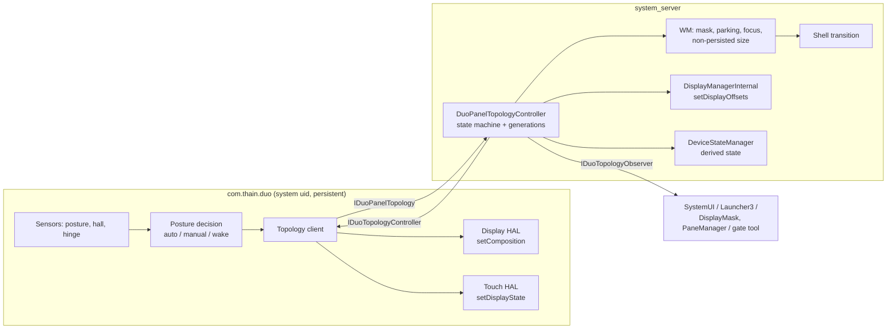
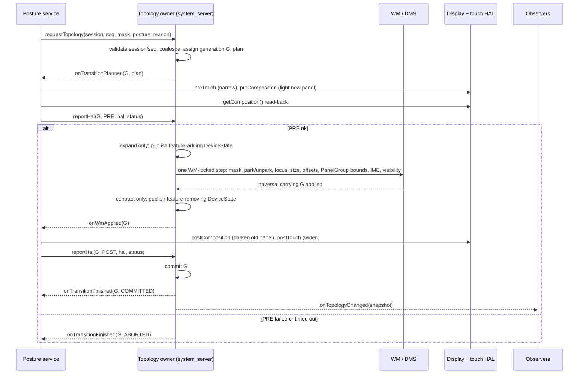

# M2.1 — Panel topology protocol and parking (design)

Status: **design only**, for review. Implementation waits for the M2.2 (Recents feasibility) decision ([plan §16.2](dual-screen-plan.md#162-m2-order)). No code in this milestone beyond this document.
Date: 2026-11-04. Target: Surface Duo 1, DUO-DE Android 16 r4, per-panel DisplayAreaGroup architecture (fw 0008).
Inputs: [dual-screen-plan.md](dual-screen-plan.md) §3, §4, §16.1 (F2, F6, F12, F13), §16.2 M2.1, §17; [m1-gate-report.md](m1-gate-report.md) G7 and hinge sensor characteristics.

## How to read the citations

Line numbers refer to the r4 tree **with the M1 gate-image patch series applied** (tag `m1-gate-image`), read-only at `\\wsl.localhost\duo-build\home\builder\aosp` on 2026-11-04. The shared tree is re-patched by other work, so files added by DUO-DE patches (`DDAPP`, `DPG`, the `FLAG_FORCE_HIDDEN_FOR_DUO_PANEL` hunks) can be absent or shifted when you read it; re-apply the series at `m1-gate-image` to reproduce. Unpatched AOSP files are unaffected. Abbreviations:

| Short | Path |
|---|---|
| `PPS` | `packages/thain/services/PostureProcessor/src/main/kotlin/com/thain/duo/PostureProcessorService.kt` (Archfx/duoPosture @ `365d924`, `build/dev/pinned.xml:36`) |
| `Tile` | `.../com/thain/duo/PostureTileService.kt` |
| `PPManifest` | `packages/thain/services/PostureProcessor/src/main/AndroidManifest.xml` |
| `wm/` | `frameworks/base/services/core/java/com/android/server/wm/` |
| `DDAPP` | `wm/DuoDisplayAreaPolicyProvider.java` (fw 0008/0014/0016) |
| `DPG` | `frameworks/base/core/java/com/android/internal/policy/DuoPanelGeometry.java` (fw 0007) |
| `display/` | `frameworks/base/services/core/java/com/android/server/display/` |
| `DMS` | `display/DisplayManagerService.java` |
| `devicestate/` | `frameworks/base/services/core/java/com/android/server/devicestate/` |
| `DSPI` | `frameworks/base/services/core/java/com/android/server/policy/DeviceStateProviderImpl.java` |
| `jetpack/` | `frameworks/base/libs/WindowManager/Jetpack/src/androidx/window/` |
| `HAL-DT`, `HAL-TP` | `vendor/surface/interfaces/displaytopology/1.0/IDisplayTopology.hal`, `vendor/surface/interfaces/touchpen/1.0/ITouchPen.hal` |
| `TIM` | `frameworks/native/services/inputflinger/reader/mapper/TouchInputMapper.cpp` |

Statements marked **(inference)** are reasoned from source but not observed on the device; each one has a matching verification item in §11 or §12.

---

## 1. Summary of the design

| Decision | Choice |
|---|---|
| Authority split | The **posture service** (`com.thain.duo`) stays the hardware interpreter and the only caller of the display and touch HALs. A new **topology owner inside system_server** (WM package, `DuoPanelTopologyController`) is the only writer of logical display size/offset, panel activation, parking and the derived DeviceState. |
| Transport | Permission- and SELinux-protected Binder service `duo_panel_topology` (`IDuoPanelTopology`), oneway controller callbacks (`IDuoTopologyController`), read-only observers (`IDuoTopologyObserver`). |
| Panel identity | Stable **physical** IDs `PANEL_0` (left in natural orientation) and `PANEL_1` (right); an active-panel **mask** that never changes with rotation. Same numbering as `DPG` `PANEL_0/PANEL_1`, HAL `LEFT/RIGHT`, WM `Panel0/Panel1`. |
| State | Separate *posture* (closed, peek, half-opened, flat, folded-back), *active-panel mask*, and task span state (owned by WM, not the protocol). Desired vs WM-applied vs HAL-applied are reported separately. |
| Ordering | Narrow touch first; light a panel before WM gives it content; darken a panel only after WM has removed content and focus from it; widen touch last. WM size + offset + mask + parking + focus change in **one WM-locked step that reaches SurfaceFlinger in one traversal**. |
| Consistency | Boot epoch + controller session ID + request sequence + owner generation; at most one transition in flight; newer requests coalesce; stale messages are dropped by generation. |
| One path | Automatic posture, manual tile, wake, HAL reconnect, controller restart and boot all become a `DuoTopologyRequest` with a `reason`. Nothing else may call `setForcedDisplaySize`/`setDisplayOffsets`/`requestState` for topology. |
| Parking | New force-hidden reason `FLAG_FORCE_HIDDEN_FOR_DUO_PARKED`, distinct from Home-minimize (`FLAG_FORCE_HIDDEN_FOR_DUO_PANEL`); cleared only by unpark or by moving the task into an active panel; never by move-to-front. Normal WM visibility/lifecycle; no process kills. |
| Logical size | Keep the single-panel logical size (1350×1800) in single-screen posture, but as a **non-persisted** topology override, not `wm size`. |
| Fold semantics | DeviceState and Jetpack `FoldingFeature` are **derived** from the committed topology by the owner. Fix the Duo 1 feature to `hinge-[1350,0,1434,1800]`; fix `config_device_state_postures` `3:4` → `3:1`. |



---

## 2. Current behaviour (verified in source)

| # | Mechanism today | Source |
|---|---|---|
| C1 | Posture service is a persistent, direct-boot, **system-uid** app (`sharedUserId android.uid.system`), started by system_server; its service is `exported="true"` without permission. | `PPManifest:6,24-25,30`; fw 0002 `SystemServer.startPostureProcessor` |
| C2 | Posture → DeviceState: `Book/Palette/PeekLeft/PeekRight` → `HALF_OPEN(1)`, `FlatDual*` → `FLAT(2)`, `Closed` → `CLOSED(0)`, **every single-screen posture → `FOLDED(3)`** regardless of side. Requested first, before any geometry change. | `PPS:456-492` |
| C3 | Then, per posture type: dual → `clearForcedDisplaySize`, offsets `(0,0)`, `setComposition(2)`; left → offsets `(-717,0)`, `setForcedDisplaySize(1350,1800)`, `setComposition(0)`; right → offsets `(+717,0)`, size, `setComposition(1)`. **Offsets are set before size** (`PANEL_OFFSET=(1350+84)/2`). | `PPS:134,512-535`; constants `res/values/integers.xml` |
| C4 | Closed → dual geometry + `setComposition(2)`; Peek → `setComposition(2)` only (size/offset untouched). | `PPS:537-555` |
| C5 | `setComposition` calls the display HAL then the touch HAL; **the HAL's `int32 error` result is ignored**; touch `setDisplayState` is `oneway` (no ack). | `PPS:315-333`; `HAL-DT` `setComposition(...) generates (int32_t error)`, `getComposition()`; `HAL-TP` `oneway setDisplayState(DisplayState)` with `LEFT, RIGHT, BOTH, NONE` |
| C6 | Manual tile → `setPosture(0/1/2)` sets size/offset/composition **without any DeviceState request** (and size before offset, the reverse of C3); mode `3` re-runs `processPosture`. While manual, sensor events still update `currentPosture` but are not applied. | `Tile:42-54`; `PPS:782-805,710` |
| C7 | Hall closed → `goToSleep(LID_SWITCH)` and unregister posture/hinge sensors after 1 s; hall open → `wakeUp(LID)` and re-register. | `PPS:724-745` |
| C8 | HAL death → reconnect and re-send `currentDisplayComposition` (a local variable; initial value `5`). | `PPS:54,813-819` |
| C9 | Peek: `isPeakMode = angle < 50`; overlay shown for peek postures. The Duo 1 guard `if (pt != 4 \|\| pt != 5)` is always true, so the overlay is hidden on every posture event first. | `PPS:360-361,505-507,546-555` |
| C10 | `IDisplayManager.setDisplayOffsets` (added by fw 0002) is a **Binder method with no permission check**; the internal one is used by burn-in protection and `DisplayFoldController`. | `DMS:4850` (BinderService), `DMS:5842-5859`, `DMS:6078`; `policy/BurnInProtectionHelper.java:153`, `policy/DisplayFoldController.java:108` |
| C11 | `setForcedDisplaySize` requires `WRITE_SECURE_SETTINGS`, **persists** the size to `Settings.Global.DISPLAY_SIZE_FORCED` and `/data/system/display_settings.xml`, and starts a `recfgDisp` change transition. Offsets live only in `LogicalDisplay` memory. | `wm/WindowManagerService.java:6385-6401`; `wm/DisplayContent.java:3295-3319,1648-1669`; `wm/DisplayWindowSettings.java:79-92`; `display/LogicalDisplay.java:997-999` |
| C12 | Offsets are applied in **natural (physical) coordinates** and rotated with the display, inside `configureDisplayLocked`; the logical rect is centred first, so ±717 puts a 1350-wide display on the left/right panel. | `display/LogicalDisplay.java:886-909` |
| C13 | DMS coalesces traversals (`mPendingTraversal`) and asks WM to run them; WM applies the display projection inside its own surface placement transaction. | `DMS:3733-3740,4332-4334`; `wm/RootWindowContainer.java:874-884` |
| C14 | The input viewport's physical frame is the projected display rect; a touch-down outside it drops the whole stroke. | `display/DisplayDevice.java:421-434`; `TIM:1714-1735,2332-2336` |
| C15 | WM panels: `PanelGroup.onConfigurationChanged` classifies the mode **by display size**; in `MODE_SINGLE` **both groups take `PANEL_0`'s rect = the whole display** (the G7(b) collapse). Launch routing gives up when the two panel rects are equal. | `DDAPP:394-410,232`; `DPG:76-86,93-99` |
| C16 | Home-minimize: `FLAG_FORCE_HIDDEN_FOR_DUO_PANEL` set on every root task of the focused panel; cleared on any move-to-front (`restoreHiddenByPolicy`) and dropped when nested under another task. | `wm/TaskFragment.java:407-424`; `DDAPP:143-196`; `wm/TaskDisplayArea.java:367-377`; `wm/Task.java:1154-1175` |
| C17 | Force-hidden ⇒ `getVisibility()` INVISIBLE ⇒ not focusable/resumable; **`Task.setForceHidden` moves a visible task to the back** of its area. | `wm/TaskFragment.java:1049-1069,1363-1366,1910-1927`; `wm/Task.java:4599-4617` |
| C18 | Sleep tokens are per `DisplayContent` (display-scoped), so they cannot park one panel. | `wm/DisplayContent.java:744,6587-6592` |
| C19 | DeviceState config has four states with names only — **no properties, no conditions**. With no conditions every state matches and the smallest ID wins, so the **base state is `CLOSED(0)`** (inference) and everything else is an override that is cancelled when the requesting process dies. | `device_phh_treble` 0001 `files/device_state_configuration.xml`; `DSPI:81-84,425-441`; `devicestate/OverrideRequestController.java:202-222` |
| C20 | WM `DeviceStateController` classifies states **by properties** when `device_state_property_migration` is on, which it is in the r4 release configs; with no properties declared, every Duo state is `UNKNOWN` to WM and `isFoldable()` is false (inference). The `config_foldedDeviceStates` overlay item is not read on that path. | `wm/DeviceStateController.java:96-125,197-232`; `build/release/aconfig/bp1a/android.hardware.devicestate.feature.flags/device_state_property_migration_flag_values.textproto` |
| C21 | Jetpack: posture = `config_device_state_postures[state]`; DUO-DE maps `3 (FOLDED) → 4`, which is not a defined `COMMON_STATE_*`. fw 0002 commented out `assertReportableState` in `CommonFoldingFeature`. | `rro_overlays/DuoDisplayFeaturesOverlay/res/values/config.xml:3-8`; `jetpack/common/DeviceStateManagerFoldingFeatureProducer.java:254-316`; `jetpack/common/layout/CommonFoldingFeature.java:217-226` |
| C22 | Duo 1 feature declaration `fold-[1392,0,1392,1800]` (zero-width fold at the hinge centre); no-hinge overlay `fold-[1350,0,1350,1800]`. Settings.Global `display_features` overrides the resource. | `rro_overlays/Duo1DisplayFeaturesOverlay/res/values/config.xml:3`; `.../Duo1NoHingeAndroidOverlay/res/values/config.xml:3`; `jetpack/common/RawFoldingFeatureProducer.java:48,61,76-85` |
| C23 | Extensions report a feature only for states FLAT/HALF_OPENED, rotate it with the display, intersect it with the window bounds and make it window-local; panel-confined windows therefore see no hinge. Sidecar (WM 1.0 clients) has **no state or empty-rect filter**. | `jetpack/extensions/layout/WindowLayoutComponentImpl.java:340-348,477-530`; `jetpack/common/ExtensionHelper.java:55-90`; `jetpack/sidecar/SidecarHelper.java:53-118` |
| C24 | The posture service broadcasts `com.thain.duo.LAUNCHER_RESTART` on dual↔single; no receiver exists in the patch series (inference: dead). | `PPS:822-830` |

### Problems the protocol must fix

- **P1 (F6)** WM has no active-side input; both single sides are the same DeviceState; the right-only posture shows panel 0's app (C2, C15).
- **P2** Size, offset, DeviceState and HAL changes are four uncoordinated calls in two orders (C3 vs C6); offset-before-size can project the 2784-wide display shifted by ±717 for a traversal, showing the other panel's content on the lit panel (inference from C12/C13).
- **P3** Manual mode bypasses DeviceState (C6), so Jetpack can report a hinge in single-screen geometry when the posture was manual.
- **P4** Forced size persists across reboot and system_server restart (C11), while offsets do not: after a runtime restart in single-screen, the 1350-wide display is centred across the hinge until the posture service re-applies (inference).
- **P5** No acknowledgement, no generation, ignored HAL errors (C5), local state reset on restart (C8).
- **P6** Any app able to reach the `display` Binder can shift or move the display (C10). The greylisted `DisplayManagerGlobal.getDisplayManagerService()` added by fw 0002 makes this easier; raw `transact` is not subject to hidden-API checks.
- **P7** Fold declaration is a zero-width fold while the hinge occludes 84 px (F12); posture `4` is undefined (C21); WM sees no fold states at all (C20).
- **P8** Other panel tasks stay resumed and focusable in single-screen (G7(b)); Home-minimize cannot be reused for parking because move-to-front clears it (C16).

---

## 3. Invariants

| ID | Invariant |
|---|---|
| I1 | A lit panel shows only content that WM has assigned to that physical panel, the spanned/default area, or black. |
| I2 | Touch is enabled only on panels that are active in **both** the previous and the next WM topology while a transition is in flight. |
| I3 | The focused task, the IME target and every resumed activity are on a panel that the HAL has confirmed lit and WM considers active, except during the bounded swap step described in §6.3. |
| I4 | WM logical size, display offset, active mask, PanelGroup bounds, parking and focus change in one WM-locked step whose display projection reaches SurfaceFlinger in one traversal (C13). |
| I5 | No message from an older controller session or an older generation changes state. |
| I6 | Parking never finishes activities, never kills processes and never changes task identity; task removal and process death follow normal Android rules. |
| I7 | DeviceState, Jetpack features, DisplayMask and PaneManager are functions of the committed topology; none of them is an input. |
| I8 | Topology state is not persisted; after any restart the owner starts from a defined boot state and reconciles with reported hardware state. |

---

## 4. State model

### 4.1 Identifiers

| Name | Values | Notes |
|---|---|---|
| `PANEL_0`, `PANEL_1` | 0, 1 | Physical, natural orientation: `PANEL_0` = HAL `LEFT`, touch `LEFT`, `DPG.PANEL_0`, WM `Panel0`/`FEATURE_PANEL_0*`. Never re-labelled by rotation (rotation is applied by `DPG.rotate`, `DPG:131-138`, and by `LogicalDisplay` for offsets, C12). |
| `mask` | `MASK_0=1`, `MASK_1=2`, `MASK_BOTH=3` | `0` is invalid for an awake device. |
| `posture` | `UNKNOWN, CLOSED, PEEK, HALF_OPENED, FLAT, FOLDED_BACK` | Semantic posture from the OEM posture sensor (`PSValue`, `PPS` enum). `FOLDED_BACK` covers brochure/tent/flip/ramp. Independent of mask (manual mode can give `FLAT` + `MASK_0`). |
| `reason` | `BOOT, AUTOMATIC, MANUAL, WAKE, HAL_RECONNECT, CONTROLLER_RESTART, RESYNC` | Diagnostics and policy only; the transition path is identical. |
| `bootEpoch` | random `long` per owner instance | Detects system_server restart. |
| `sessionId` | `int`, owner-assigned per `registerController` | Old sessions are dead. |
| `requestSeq` | `long`, controller-assigned, strictly increasing per session | Duplicate/out-of-order rejection. |
| `generation` | `long`, owner-assigned, strictly increasing per boot | One per planned transition; acks carry it. |

Composition mapping (single table, owned by the protocol): `MASK_0 → HAL LEFT(0) / touch LEFT(0)`, `MASK_1 → RIGHT(1) / RIGHT(1)`, `MASK_BOTH → COMPOUND(2) / BOTH(2)`; transient touch `NONE(3)`. Offsets: `MASK_0 → (-(panel+hinge)/2, 0)`, `MASK_1 → (+(panel+hinge)/2, 0)`, `MASK_BOTH → (0,0)`, with `hinge=0` in no-hinge mode (`PPS:159-161`). Computed from `DPG.DUO` in the owner, not from posture-service resources.

### 4.2 Desired, applied, committed

The owner keeps four records, all visible in the snapshot:

- **desired** — latest accepted request (mask, posture, peek, reason, requestSeq).
- **wmApplied** — mask and generation that WM last applied (size, offset, mask, parking).
- **halApplied** — last controller report: composition read back with `getComposition()`, touch state last sent, HAL connection status.
- **committed** — generation for which desired == wmApplied == halApplied.

Phases of the single in-flight transition: `IDLE → PLANNED → PRE_HAL_APPLIED → WM_APPLIED → COMMITTED`, or `ABORTED`, or `DEGRADED` (WM and HAL disagree after a timeout or HAL failure; I1/I2 still hold, see §6.4).

### 4.3 What the protocol does not carry

Task span state, task-to-panel ownership and restore destinations stay in WM (plan §4 "Task policy"). Rotation is reported for diagnostics only; WM owns it. Hinge angle is not part of the topology (it stays posture-service input and touch-HAL input, `PPS:354-365`); F13 logging (§12) records it next to topology events.

---

## 5. Binder interface (AIDL sketch)

Package `com.android.internal.duo` (framework, `@hide`). Name chosen to avoid confusion with AOSP `android.hardware.display.DisplayTopology` (`DMS:116,621`) and the vendor `displaytopology` HAL.

```aidl
// Registered in ServiceManager as "duo_panel_topology" by system_server, only when
// DuoPanelGeometry.forDevice(Build.DEVICE) != null.
interface IDuoPanelTopology {
    // ---- controller (posture service) ----
    // Replaces any dead controller; rejects a second live one. Returns the session and the
    // owner snapshot so a restarted controller resumes from the owner's state.
    DuoTopologySession registerController(IDuoTopologyController controller,
            in DuoHalState halAtConnect);
    oneway void requestTopology(int sessionId, in DuoTopologyRequest request);
    oneway void reportHal(int sessionId, long generation, int step /* PRE, POST, RECONCILE */,
            in DuoHalState hal, int status /* OK, HAL_ERROR, HAL_DISCONNECTED */);

    // ---- observers (read-only) ----
    DuoTopologySnapshot getSnapshot();
    void registerObserver(IDuoTopologyObserver observer);
    void unregisterObserver(IDuoTopologyObserver observer);
}

oneway interface IDuoTopologyController {
    // Do the pre-WM HAL steps of `plan`, then reportHal(PRE).
    void onTransitionPlanned(in DuoTransitionPlan plan);
    // WM step is on screen (the traversal that carries it has been applied).
    // Do the post-WM HAL steps, then reportHal(POST).
    void onWmApplied(long generation);
    void onTransitionFinished(long generation, int result /* COMMITTED, ABORTED, DEGRADED */,
            in DuoTopologySnapshot snapshot);
    // Owner asks the controller to re-read sensors and HAL and send a fresh request.
    void onResyncRequested(in DuoTopologySnapshot snapshot);
}

oneway interface IDuoTopologyObserver {
    void onTopologyChanged(in DuoTopologySnapshot snapshot);   // committed changes only
}

parcelable DuoTopologyRequest {
    long requestSeq;
    int mask;               // MASK_0 | MASK_1 | MASK_BOTH
    int posture;            // UNKNOWN..FOLDED_BACK
    boolean peekOverlay;    // posture service shows its peek clock
    int reason;             // BOOT..RESYNC
    long sensorTimestampNs; // posture event time, for F13 correlation
}

parcelable DuoHalState {
    int composition;        // getComposition() read-back, -1 unknown
    int touchState;         // last value sent (oneway, cannot be read back)
    boolean displayHalConnected;
    boolean touchHalConnected;
    int lastHalError;       // setComposition() result, 0 = OK
}

parcelable DuoTransitionPlan {
    long generation;
    int fromMask;  int toMask;
    int preTouch;          // -1 = unchanged
    int preComposition;    // -1 = unchanged (set only when lighting a panel)
    int postComposition;   // -1 = unchanged (set only when darkening a panel)
    int postTouch;         // -1 = unchanged
    long preDeadlineUptimeMs;
    long postDeadlineUptimeMs;
}

parcelable DuoTopologySnapshot {
    long bootEpoch;  int sessionId;
    long committedGeneration;  long inFlightGeneration;  int phase;
    DuoTopologyRequest desired;
    int wmAppliedMask;  long wmAppliedGeneration;
    DuoHalState halApplied;
    int posture;  boolean peekOverlay;
    int derivedDeviceState;           // §9
    int rotation;                     // diagnostics
    boolean panelPolicyActive;        // same as sys.duode.panels.active (fw 0016)
    long lastChangeUptimeMs;
}

parcelable DuoTopologySession { int sessionId; long bootEpoch; DuoTopologySnapshot snapshot; }
```

### 5.1 Permission protection

| Layer | Rule |
|---|---|
| Permissions | New framework permissions `android.permission.CONTROL_DUO_PANEL_TOPOLOGY` (`signature`) and `android.permission.OBSERVE_DUO_PANEL_TOPOLOGY` (`signature\|privileged`), declared in `core/res/AndroidManifest.xml`. Controller methods enforce the first; observer methods the second. |
| Controller identity | The posture service shares `android.uid.system` (C1), so the permission alone admits every system-uid process. `registerController` additionally requires `callingUid == SYSTEM_UID` and that the calling pid's process name is `com.thain.duo` (via `ActivityManagerInternal`), and accepts one live controller (linked to death). Session ID binds all later calls. |
| SELinux | New `duo_panel_topology_service` type (`system_server_service, service_manager_type`); `service_contexts` entry `duo_panel_topology`; `allow system_app ...:service_manager find;` plus `platform_app` for SystemUI/Launcher3 observers. Lives in `device_phh_treble/sepolicy`, next to the existing `duo_service` entry (device_phh_treble 0001 `sepolicy/service.te`, `service_contexts`). |
| Remove side doors | Delete the Binder `IDisplayManager.setDisplayOffsets` and the greylisted `getDisplayManagerService()` added by fw 0002 (C10, P6); keep `DisplayManagerInternal.setDisplayOffsets` for in-process callers. The posture service stops calling `IWindowManager.setForcedDisplaySize`/`clearForcedDisplaySize` and `DeviceStateManager.requestState`. The legacy `LAUNCHER_RESTART` broadcast is removed (observers replace it). |
| Debug | `dumpsys duo_panel_topology` (snapshot + last 64 transitions with timings); `cmd duo_panel_topology request <mask> <posture>` on `userdebug` only, enforcing `CONTROL_DUO_PANEL_TOPOLOGY` (shell does not hold it, so tests run the command through the posture service's test hook or `su`; open question Q11). |

---

## 6. Transition protocol

### 6.1 Sequence



### 6.2 Plans by transition class

| Class | From → to | Pre (posture service) | WM step | Post (posture service) | DeviceState publish |
|---|---|---|---|---|---|
| Expand | `MASK_x` → `BOTH` | composition `COMPOUND`, verify read-back; touch unchanged (`x`) | unpark other panel; size override cleared; offsets `(0,0)`; panel rects | touch `BOTH` | before WM (adds features) |
| Contract | `BOTH` → `MASK_x` | touch `x` | park other panel; focus to `x`; size 1350×1800; offsets for `x` | composition `x`, verify | after WM (removes features) |
| Swap | `MASK_x` → `MASK_y` | touch `NONE` (fallback: unchanged, §12 Q3) | park `x`, unpark `y`, focus to `y`, offsets for `y` (size unchanged) | composition `y`, verify; touch `y` | none (`FOLDED` → `FOLDED`) |
| Posture only | same mask | — | — (owner commits immediately) | — | immediately |
| Reconcile | same mask | — | — | controller re-sends composition + touch for the committed mask, `reportHal(RECONCILE)` | — |

Rationale per I1–I3:

- Expand lights the new panel **before** WM places content on it. While only the projection of the single-panel display exists, the new panel shows black because it is outside the projected rect (C12) **(inference: verify SurfaceFlinger clears outside the projection on this HWC)**. If lighting fails, the transition aborts before any task or focus is placed on the dark panel.
- Contract narrows touch first, so the panel about to go dark cannot deliver a stroke into content that is being moved; WM then removes content and focus; only then is the panel darkened. If darkening fails, the extra panel stays lit showing black (outside the projection) — safe, reported `DEGRADED`.
- Swap cannot light both single panels without `COMPOUND`. Default: WM first, composition after, touch `NONE` in between. For one HAL round-trip the focused task is on a dark panel (the exception allowed by I3). The alternative bridge (`x → COMPOUND → WM → y`) satisfies I3 strictly but lights the unviewed panel briefly; choose after measuring HAL latency (Q4).
- Touch outside the projected rect is dropped by InputReader regardless of touch-HAL state (C14), so I2 holds even if the oneway touch call is late; the touch HAL step is defence in depth **(inference: verify the input viewport update and the projection change reach InputReader before the next stroke)**.

### 6.3 Inside the WM step (system_server)

Runs on the owner's handler thread, holding `WindowManagerGlobalLock` for the whole step:

1. Start, or join, a `TRANSIT_CHANGE` on the default display through the same chain used by `DisplayContent.reconfigureDisplayLocked` (`wm/DisplayContent.java:1648-1669`), and collect both PanelGroups and every root task whose park state changes (as `DDAPP:153-158` does for Home).
2. Set the policy's active mask. `PanelGroup.onConfigurationChanged` and `panelForLaunch` read the mask instead of classifying by size (`DDAPP:232,394-410`). Single-screen bounds: the active group takes the full logical display; the parked group **also** keeps the full logical display (its tasks are hidden), so parked tasks keep a 1350×1800 configuration and do not see a size change on fold or unfold (inference; measured in §11 A14).
3. Park / unpark (§7). Parking records the parked area's root-task order and restores it on unpark, because `Task.setForceHidden` moves visible tasks to the back (C17).
4. Focus: if the focused root task, or the IME layering target, is now parked, move focus to the top focusable task of the active panel, else to Home in the default area. Never move focus into a parked panel. Unparking does not move focus or reorder across panels (non-always-on-top tasks are not moved to front by `setForceHidden(false)`, `wm/Task.java:4611-4613`).
5. Size: apply a **non-persisted topology size override** on the default `DisplayContent` (new field consulted where the forced size is; does not call `DisplayWindowSettings.setForcedSize`, C11). Offsets: `DisplayManagerInternal.setDisplayOffsets` (`DMS:6078`). Both inside the same lock section, before any surface placement, so one coalesced traversal carries both (C13) **(inference: assert with an SF/WM trace that no transaction contains one without the other)**.
6. `reconfigureDisplayLocked` (via the size change) → PanelGroup bounds, `refreshImeBounds` (existing, called at the start of `updateOrder`, `DDAPP:258-260`), then `ensureActivitiesVisible` and resume of the active panel's top activities.
7. Set the transition ready; record `wmApplied = G`. Send `onWmApplied(G)` after the surface placement that ran `performTraversal` for G (`wm/RootWindowContainer.java:883`), not merely after the lock is released.

The owner never calls into the posture service while holding the WM lock.

### 6.4 Failures, timeouts and coalescing

| Situation | Owner behaviour | Resulting state |
|---|---|---|
| New request while one is in flight | Store as `desired`; finish the in-flight one; then plan `committed → desired` directly (intermediate requests are dropped, not queued). | One transition at a time; bounded latency (Q5). |
| PRE not reported by `preDeadline` (proposed 750 ms) or `status != OK` | Abort; no WM change; `onTransitionFinished(ABORTED)`; schedule `onResyncRequested` after back-off (250 ms, 1 s, 4 s). | Old topology; HAL may have narrowed touch or lit a black panel — both satisfy I1/I2. |
| POST not reported by `postDeadline` (proposed 1 s) or HAL error | Keep WM state (already safe); phase `DEGRADED`; resync with back-off. On swap, if the new panel still is not lit after the third attempt, plan a swap back to the old panel (I3). | WM authoritative; observers see `DEGRADED`. |
| WM step throws | Log WTF; leave the transition collected so Shell finishes it; abort with `DEGRADED`; next request re-plans from `wmApplied`. | — |
| Message with wrong `sessionId`, `requestSeq <= last`, or `generation != inFlight` | Drop and log (counted in dump). | I5. |
| Controller dies (`linkToDeath`) | Keep the committed WM topology (do **not** revert to dual: the HAL keeps its last composition, and a dual WM topology would place resumed, focusable tasks on a dark panel). If a transition was in `PLANNED`/`PRE`, abort; if `WM_APPLIED`, mark `DEGRADED`. | Wait for re-registration. |
| Observer dies | Unregister. | — |

### 6.5 One path for every trigger

| Trigger | Posture service | Owner |
|---|---|---|
| Automatic posture | Sensor event → posture decision (unchanged logic, `PPS:692-716`) → `requestTopology(AUTOMATIC)` only when the desired mask or posture changes. | Normal plan. |
| Manual tile | `Tile` cycle sets the manual mode; the posture service sends `requestTopology(MANUAL, mask)` with the current sensor posture; returning to automatic sends the sensor-derived request. | Normal plan; DeviceState now follows manual geometry (fixes P3). |
| Lid close (hall 0) | `goToSleep` as today (C7); send `requestTopology(posture=CLOSED, mask=committed mask)`. | Posture-only: DeviceState `CLOSED`, **no WM change while asleep** (today's code switches to dual on close, C4) — Q6. |
| Wake (hall 1) | Re-register sensors; on the first posture sample send `requestTopology(WAKE)`. Until then nothing. | Normal plan from the committed state. |
| Display/touch HAL death | Reconnect; send `reportHal(RECONCILE)` after re-applying composition and touch for the **committed** mask from the snapshot (replaces `currentDisplayComposition`, C8). | If read-back disagrees with the committed mask, request resync. |
| Posture service restart | `registerController(halAtConnect)` with `getComposition()`; adopt the returned snapshot; then send a request from fresh sensors with reason `CONTROLLER_RESTART`. | New session; old session's in-flight work handled as in §6.4. |
| system_server restart | Process is killed with system_server and restarted (C1). Same as above, but the snapshot has a new `bootEpoch` and `committed = BOOT`. | §10. |
| Peek | `requestTopology(posture=PEEK, peekOverlay=true, mask=…)`; overlay UI stays in the posture service. | Posture-only unless the mask changes. |

---

## 7. Parking semantics

### 7.1 Mechanism

- New reason `FLAG_FORCE_HIDDEN_FOR_DUO_PARKED = 1 << 4` in `TaskFragment` (`wm/TaskFragment.java:407-424`), owned by the topology owner. Home keeps `FLAG_FORCE_HIDDEN_FOR_DUO_PANEL` (fw 0014). Both may be set on one task.
- Set on every root task directly in the parked panel's TaskDisplayArea; any root task **added to or reparented into** a parked area also gets it (hook next to the existing nested-task rule in `Task.onParentChanged`, `wm/Task.java:1154-1175`).
- Cleared only by (a) unpark of that panel, or (b) the task being reparented into an **active** area. **Not** cleared by `restoreHiddenByPolicy` / move-to-front (`DDAPP:184-196`, `wm/TaskDisplayArea.java:372-377`), so launches, Recents and focus moves cannot unpark a dark panel (the reason the plan rejected reusing the Home bit).
- Visibility, lifecycle, focus and input follow from force-hidden through normal WM paths (C17): invisible ⇒ stopped, not resumable, not focusable; invisible windows leave the input window list **(inference: verify in `dumpsys input` during G7)**. Sleep tokens are not used (C18). Processes are never killed by the policy.
- Self-check after every visibility pass (`DDAPP.updateOrder`, called from `wm/RootWindowContainer.java:1861-1862`): every root task in a parked area carries the bit, none in an active area does; violations are fixed and logged WTF.
- PiP, the spanned/default area and Home are never parked: in single-screen the default area covers the active panel (contract §3: a spanned task adapts to the enabled panel).

### 7.2 Behaviour by case

| Case | Behaviour |
|---|---|
| Fold to single `x` | Other panel's root tasks parked (stopped, invisible, unfocusable); order recorded. Spanned tasks stay visible, resized to the panel. Focus moves to `x`'s top task or Home. |
| Unfold | Parked panel's tasks unparked in the recorded order; a task still carrying the Home bit stays hidden, so that panel shows Home (Home → fold → unfold restores Home, F2). Focus is not moved. |
| Home while single | `minimizeFocusedPanel` acts on the active panel (unchanged, `DDAPP:143-167`); parked panel untouched. |
| Launch that reuses a parked task (icon, notification, deep link, `singleTask`, Recents selection) | Launch resolution redirects the target area to the active panel; the task is reparented (same task ID, back stack, saved state), which clears `PARKED`; then move-to-front clears any Home bit as today. The task now belongs to the active panel and stays there after unfold (a user action moved it; matches the §3 "re-span only if not moved" rule). Implemented next to `panelForLaunch` (`wm/LaunchParamsUtil.java:315-324`). |
| New task while single | Active panel or the default area; never a parked area. |
| Explicit `launchTaskDisplayAreaFeatureId` naming a parked panel (`wm/LaunchParamsUtil.java:300-313`) | Default: redirect to the active panel and log. Exception for a future "restore app pair in background" option: land parked (Q7). |
| Context-free launch (F20) | Single: active panel. Dual: M2.5. |
| Cross-panel move while single | Not offered by UI; a programmatic request is rejected with an explicit error rather than silently parking the task. |
| Process death of a parked app | Task and stopped `ActivityRecord`s remain with saved state; relaunch on unpark is normal Android restore. Identity and back stack guaranteed, process survival not. |
| Task removed while parked (Recents swipe, `am stack remove`) | Normal removal. |
| Keyguard while single | Display-wide keyguard covers the active panel. A parked `showWhenLocked` activity stays hidden (PARKED wins); M2.3 owns occlusion. |
| Rotation while single | Mask unchanged; offsets are natural and rotated by `LogicalDisplay` (C12); `DPG.layout` rotates panel rects. |
| Posture service restart | Parking state is WM-owned and unchanged; controller resyncs. |
| system_server restart | All tasks are rebuilt from persisted Recents; no parked bit survives; owner boots dual (§10). |
| Panel mode off (`persist.*.duo.panels=0`) | No panel areas, nothing to park; the owner still applies size, offset and DeviceState atomically through the same protocol, so single-screen behaviour matches today's (M2.5 "panel-off unchanged"). |

---

## 8. Input and content safety between steps

| Interval | Lit panels | Touch (HAL) | Touch (InputReader frame) | WM content | Safe because |
|---|---|---|---|---|---|
| Contract, after pre | both | `x` | old viewport (both) | dual | other panel cannot be touched; both panels show their own content (I1). |
| Contract, after WM | both | `x` | `x` only | single `x`, other parked | other panel is outside the projection: black (I1). |
| Expand, after pre | both | `x` | `x` only | single `x` | new panel black; no touch on it. |
| Expand, after WM | both | `x` | both | dual | new panel shows its unparked tasks; no touch on it yet. |
| Swap, after pre | `x` | none | `x` | single `x` | no input. |
| Swap, after WM | `x` | none | `y` | single `y` | `x` black, `y` dark with focus (bounded by POST deadline). |
| Any, controller dead | last | last | follows WM | last committed | WM never moves content onto a panel without a HAL ack. |

Keyboard focus follows WM focus (step 4); hardware-key and IME input therefore never target a parked task. The posture service's overlays (posture overlay, peek clock) are `TYPE_APPLICATION_OVERLAY` with `FLAG_NOT_TOUCHABLE` (`PPS:235-246`) and do not affect input.

---

## 9. Derived fold semantics

### 9.1 DeviceState

The owner, not the posture service, requests the DeviceState, as a **base-state override** (`requestBaseStateOverride`, `CONTROL_DEVICE_STATE`, `devicestate/DeviceStateManagerService.java:1526-1543`) from system_server. The base state from `DSPI` is the static `CLOSED(0)` (C19), the requester is system_server, so the override cannot be cancelled by a posture-service crash (today's override is, C19) **(inference: verify `dumpsys device_state` shows base 0 and the override owner)**.

| Committed topology | DeviceState | `config_device_state_postures` (fixed) | Jetpack in a spanned window |
|---|---|---|---|
| posture `CLOSED` | `0 CLOSED` | `0:1` (no folding features) | none |
| `MASK_BOTH` + `HALF_OPENED` or `PEEK` | `1 HALF_OPENED` | `1:2` | hinge, `HALF_OPENED` |
| `MASK_BOTH` + `FLAT` (or `UNKNOWN`) | `2 OPENED` | `2:3` | hinge, `FLAT` |
| `MASK_0` or `MASK_1` (any posture) | `3 FOLDED` | **`3:1`** (was `3:4`, undefined) | none |

- Feature-adding states are published before the WM step (expand); feature-removing states after it (contract). Mixed intermediate combinations then produce **no** feature, never a wrong one: Extensions intersect the declared rect with the current display and the window and drop empty results (C23); a 1350-wide single display does not intersect `[1350,1434]` because `Rect.intersect` is strict (`jetpack/common/ExtensionHelper.java:67,85-90`). This edge-exactness is fragile; §11 tests it.
- With `3:1`, fw 0002's commented-out `assertReportableState` no longer matters (parse failures are caught at `CommonFoldingFeature.java:130-145`); restore it as cleanup.
- **No WM fold properties in M2.1.** WM currently sees every Duo state as `UNKNOWN` (C20), so DeviceState does not drive WM rotation, tabletop or letterbox policy, and the SystemUI unfold animation enabled by `config_unfoldTransitionEnabled` (`DuoDisplayFeaturesOverlay/res/values/config.xml`) has no folded state to animate **(inference)**. Declaring `PROPERTY_FOLDABLE_*` would switch those consumers on; that needs the consumer audit listed as a later alternative in the plan (Q8). WM topology comes from the protocol, not from DeviceState.

### 9.2 Jetpack WindowLayoutInfo / FoldingFeature

- Fix `Duo1DisplayFeaturesOverlay` to **`hinge-[1350,0,1434,1800]`** (natural orientation, logical == physical in dual). Keep the no-hinge overlay `fold-[1350,0,1350,1800]` (gapless seam). Do not set `Settings.Global display_features` (it overrides the resource, C22); the gate collector asserts it is empty.
- Semantics delivered to apps (androidx.window library behaviour, external to r4, **inference from the library contract**): `type = HINGE`, `orientation = VERTICAL` at rotation 0/180 and `HORIZONTAL` at 90/270, `occlusionType = FULL` (non-zero area), `isSeparating = true` for a hinge in both FLAT and HALF_OPENED, `bounds` window-local.
- Window-local transform: rotate with the window's display rotation, intersect with the window bounds, offset to the window (`WindowLayoutComponentImpl.java:477-530`, `ExtensionHelper.java:55-90`). Panel windows (`[0,1350]`, `[1434,2784]`) get no feature; spanned windows get `[1350,1434]` relative to their left edge; feature must start at the window's top or left and span its full height/width (`WindowLayoutComponentImpl.java:503-526`).
- Sidecar clients (WM 1.0, e.g. Microsoft apps) get features without state filtering and may receive an empty rect in single-screen (`SidecarHelper.java:105-118`); assert that no non-empty hinge reaches a Sidecar client in single-screen or in a panel window.
- `DisplayMask` and `PaneManager` (device_phh_treble 0008/0011/0015) classify by display size today; they become observers of `IDuoTopologyObserver` (M2.5, F3) so manual and automatic modes agree.

---

## 10. Restart and recovery matrix

| Event | Owner start state | HAL state | Recovery |
|---|---|---|---|
| Cold boot | `BOOT`: `MASK_BOTH`, no size override, offsets 0, DeviceState override `OPENED`, `committed=0`. Migration: clear a stale `DISPLAY_SIZE_FORCED` equal to the panel size written by the legacy path (C11, P4). | Vendor default **(inference: `COMPOUND`)** | Controller registers with `getComposition()`; owner reconciles; first sensor sample decides. |
| system_server restart (soft reboot) | Same as cold boot; new `bootEpoch`. No persisted size exists any more (I8). | Last composition survives (vendor HAL process) | If HAL is single and the owner is dual, the lit panel shows its own panel's content (dual projection is physically correct, I1); the controller's first request contracts properly. |
| Posture service crash/restart | Keeps committed topology; `controller=null`. | Unchanged | §6.5. |
| HAL process restart | Unchanged | Vendor default | Controller reconciles from the snapshot (§6.5). |
| WM transition stuck | Shell/WM timeouts finish it; owner marks `DEGRADED` if `onWmApplied` was never sent within 3 s. | Pre-step state | Resync. |

---

## 11. Test plan and gate assertions

### 11.1 Host tests (no device; add to the harness `dev/tests` or framework host tests)

1. **Planner model check.** Enumerate every `(fromMask, toMask, posture, reason)` and every interleaving of PRE/WM/POST completion, failure and timeout, controller death and new requests; assert I1, I2, I3 (with the swap exception bounded), I5 in every reachable state.
2. **Session/generation state machine.** Stale session, duplicate and reordered `requestSeq`, acks for wrong generation, coalescing (N rapid requests → at most two transitions), restart at each phase.
3. **Derivations.** Mask → offsets/composition/touch; topology → DeviceState table (§9.1); rotation independence of masks.
4. **Feature conformance.** Run the r4 Extensions and Sidecar transforms (pure functions) over `{dual, single-0, single-1, gapless}` × rotations 0–270 × windows `{panel 0, panel 1, spanned, default-in-single}` × DeviceStates, **including mixed intermediate (geometry, state) pairs**; assert no panel window ever gets a feature, spanned windows get exactly the 84 px hinge, single-screen gets none. Do not validate with `DuoPanelGeometry` alone (plan §16.4).

### 11.2 WM tests (`WmTests`, device-run)

Parking bit set/cleared only by the owner; not cleared by `restoreHiddenByPolicy`/move-to-front; cleared on reparent into an active area; added on reparent into a parked area; Home bit and parked bit independent; recorded order restored; focus never lands in a parked area; launch redirect keeps task ID and back stack; explicit TDA redirect; size override not persisted; size and offset in one traversal.

### 11.3 Fault injection (userdebug device)

Kill the posture service in each phase (debug hook that stalls before `reportHal`); make `setComposition` fail (debug property in the posture service); induce HAL death if a safe method exists (Q9); kill system_server in single-screen; out-of-order requests from a test client holding the permission.

### 11.4 Gate assertions (M2.1 exit, folded into G7/G8 and the §16.4 collector)

| ID | Assertion | Evidence |
|---|---|---|
| A1 | After every commit: snapshot `desired.mask == wmAppliedMask`, HAL read-back composition matches, touch state matches, generation strictly increasing; no `DEGRADED` lasting > 2 s. | `dumpsys duo_panel_topology`, collector |
| A2 | Right-only shows panel 1's top task, left-only panel 0's; ten physical folds per side, at rotations 0/90/180/270 (manual visual of the lit panel + screenshot). | Operator + collector |
| A3 | Parked tasks: STOPPED, not visible, not focusable, absent from the input window list, `PARKED` set. | `dumpsys activity/window/input` |
| A4 | Touch sentinel on the dark panel reaches no window. Real input receipt on the active panel (plan §16.4). | Sentinel probe |
| A5 | Unfold restores each panel's top task, back stack and state; also after Home, after `am kill` of a parked app, after rotation while folded. | Probe state checks |
| A6 | Launching a parked task from the active launcher, from a notification and from Recents puts the same task ID on the active panel; it stays there after unfold. | Collector |
| A7 | Manual tile cycle (Auto → Left → Both → Right → Auto) produces `reason=MANUAL` transitions and a matching DeviceState. | Dump + `dumpsys device_state` |
| A8 | Posture-service kill in single and in dual: no WM change while it is absent; correct reconcile after restart; no wrong-panel content. | Dump + recording |
| A9 | Lid close/open in single: no topology change while asleep; wake applies the fresh posture. | Dump |
| A10 | DeviceState equals §9.1 after each commit; DuoProbe `WindowLayoutInfo`: panel windows none, spanned window one hinge 84 px `FULL`/separating, single-screen none, never a feature in a panel window. | Probe |
| A11 | `settings get global display_size_forced` and `display_features` stay empty; no `display_settings.xml` forced size written by topology changes. | Shell |
| A12 | Transition recording (G8): no frame in which a lit panel shows the other panel's content; size and offset land in one SurfaceFlinger transaction. | High-speed recording + SF/WM trace |
| A13 | Relaunch and configuration-callback counts per fold for panel apps, with and without `configChanges` (target: no relaunch for panel tasks; measured, not assumed). | Probe lifecycle log |
| A14 | Unauthorized callers: an app and `shell` get `SecurityException` from controller methods; `IDisplayManager.setDisplayOffsets` no longer exists. | Negative-control test app |
| A15 | Panel-off mode: single-screen behaviour unchanged from today except atomic size/offset and DeviceState. | Collector panel-off run |

Manual-only items (plan §16.4): physical folds, lit/dark identity, sensor timing, recording review.

---

## 12. Open questions and risks

### Top risks

| # | Risk | Mitigation / decision point |
|---|---|---|
| R1 | **Vendor HAL semantics are unknown**: what `setComposition(LEFT/RIGHT)` does to scan-out, its latency and error codes, whether `getComposition()` reflects the applied state, and whether touch `NONE` behaves on Duo 1 (the Duo 2 code needs an interactivity reset after `LEFT`, `PPS:277-294`). The whole ordering relies on these. | First implementation step: an instrumented posture-service build that logs per-call latency and read-back; measure before choosing swap ordering (Q3, Q4). |
| R2 | **Size/offset atomicity** may not hold if WM's display-info override and the DMS offset can land in different traversals, or if app buffers lag the projection (one-frame wrong-panel content, P2). | Same-lock-section design (§6.3); A12 trace; fallback: a single `DisplayManagerInternal` call that sets offset and size override together. |
| R3 | **Shell display-change transition** for a 2784↔1350 resize: animation, screenshot layer and leash cropping are unverified; a screenshot crossfade could briefly show stale content of the parked panel. | G8 recording; coordinate with M2.2 findings on leash containment. |
| R4 | **Parking reorders tasks** (`Task.setForceHidden` moves to back, C17); without the recorded order, unfold could surface the wrong task. | §6.3 step 3; WM test. |
| R5 | **Launch redirect breadth**: many start paths resolve areas (launch params, Recents, `anyTaskForId`, organizer roots); a missed path lands a task in a parked area (hidden) or pulls it into the spanned area (G3-like). | Single redirect in launch params + self-check in `updateOrder` + A6 across sources. |
| R6 | **DeviceState consumers**: declaring fold properties later would enable WM/SystemUI behaviours (unfold animation, tabletop) that were never tested on a same-display dual-panel device. | Keep properties off in M2.1 (§9.1); audit before enabling. |
| R7 | **Single-writer assumption**: any remaining caller of `wm size`, offsets or DeviceState (developer tools, Settings "display size", burn-in protection) desynchronises topology. | Remove the Binder offset method; owner rejects/logs user forced-size changes on the default display while panel policy is active (Q10). |
| R8 | **Patch logistics**: the harness has patch directories for AOSP projects but none for `packages/thain/*` (Archfx/duoPosture, Archfx/duoOverlays are pinned, `build/dev/pinned.xml:34,36`). | Add patch support for those projects (or pinned forks) before implementation. |

### Open questions

- **Q1** Does SurfaceFlinger/HWC present black outside the projected rect on the newly lit panel during expand, or stale framebuffer content?
- **Q2** Does the InputReader viewport update arrive before the first post-transition stroke, and what happens to a stroke that is in progress when the viewport changes?
- **Q3** Touch `NONE` on Duo 1: supported and recoverable? If not, swap keeps touch on the old panel and relies on InputReader's frame check.
- **Q4** Swap ordering: WM-first (default) vs `COMPOUND` bridge; decide from measured HAL latency.
- **Q5** Coalescing latency: is "finish in-flight, then jump to latest" fast enough during quick flips, or is pre-WM cancellation needed?
- **Q6** Lid closed: keep the last mask (proposed, avoids churn while asleep) vs today's switch to dual (C4). Peek on Duo 1: should the overlay cover a single active panel, and should content under the translucent clock be hidden?
- **Q7** Explicit TDA requests for a parked panel: always redirect, or allow background placement for app-pair restore?
- **Q8** Which WM/SystemUI DeviceState consumers should eventually see fold properties, and is a system_server `DeviceStateProvider` (instead of a base-state override) worth it?
- **Q9** Is there a safe way to induce display/touch HAL death on the dev unit for A8-style tests?
- **Q10** Interplay with a user-chosen `wm size`/display size: reject while panel policy is active, or compose (topology override wins in single, user size in dual)?
- **Q11** Test access: a userdebug-only `cmd` path vs a test hook in the posture service; neither may weaken the production permission.
- **Q12** Rotation hints: the display HAL `onRotation` (1.1) and touch `displayOrientation` are never called today; does Duo 1 touch need them in single-screen landscape?
- **Q13** F13: posture decisions stay in the posture service and are not filtered in M2.1; the protocol adds `sensorTimestampNs` and transition logs so the anomaly can be correlated (hinge, OEM posture, hall, requested/applied composition, size/offset).

---

## 13. Implementation slices (after the M2.2 decision)

1. Framework: AIDL, permissions, SELinux, owner state machine with no WM effect yet (dump only); host tests 11.1.
2. Posture service client behind a property, legacy path kept as fallback until A1–A9 pass; HAL read-back and error handling.
3. WM step: mask-driven PanelGroup and launch routing, non-persisted size override, offsets, focus/IME; remove `IDisplayManager.setDisplayOffsets`.
4. Parking flag, order record/restore, launch redirect, self-check; WM tests 11.2.
5. Derived DeviceState, overlay `hinge-[1350,0,1434,1800]`, posture map `3:1`; feature conformance tests; DisplayMask/PaneManager observers (with M2.5 F3).
6. Collector support for A1–A15; full gate run on one integration image; Astra review.
